# Software Development Portfolio

**Syed's IT Solution & Digital Marketing Services** — team-led engineering services, guided by **Syed Hasnain Raza**. Websites, landing pages, ERP/CRM/CMS, SaaS, mobile and desktop applications, e-commerce, APIs, AI and automation.

[Technology matrix](./TECHNOLOGY_STACK.md) · [Complete solutions catalog](./SERVICES.md)

[**✉️ Discuss a project**](mailto:razahasnain0300@gmail.com?subject=Software%20Project%20Inquiry) · [**Back to Profile**](./README.md)

---

## Software development services

Our team works on **websites, all types of landing pages, ERP, CRM, CMS, HRMS, POS, LMS, SaaS, web applications, Android/iOS and desktop software, custom dashboards, APIs, e-commerce, automation and integrations**. This is a capability overview, not a claim that each project has a public live demonstration.

An automatically maintained project gallery, backed by approved, privacy-conscious public showcases. Each image below is an **illustrative design mockup**, not a real application screenshot. Project descriptions are intentionally high level. This public document does **not** contain the underlying private source code, credentials or deployment configuration.

[← Back to GitHub profile](./README.md)

<!-- AUTO-FULL-GALLERY:START -->
## Project gallery · Newest first

**14 showcased projects** · 0 public-source repositories · 14 approved private-source previews

Newest discoverable repositories appear first. The remaining private-source projects follow an intentionally curated order; their exact creation dates are not publicly verified.

<table>
<tr>
<td width="50%" align="center" valign="top"> <b>PRIVATE-SOURCE CONCEPT</b> · Healthcare / Education</td>
<td width="50%" align="center" valign="top"> <b>PRIVATE-SOURCE CONCEPT</b> · Healthcare platform</td>
</tr>
<tr>
<td width="50%" align="center" valign="top"> <b>PRIVATE-SOURCE CONCEPT</b> · E-commerce</td>
<td width="50%" align="center" valign="top"> <b>PRIVATE-SOURCE CONCEPT</b> · Retail</td>
</tr>
<tr>
<td width="50%" align="center" valign="top"> <b>PRIVATE-SOURCE CONCEPT</b> · CRM / Operations</td>
<td width="50%" align="center" valign="top"> <b>PRIVATE-SOURCE CONCEPT</b> · Desktop / AI</td>
</tr>
<tr>
<td width="50%" align="center" valign="top"> <b>PRIVATE-SOURCE CONCEPT</b> · Healthcare platform</td>
<td width="50%" align="center" valign="top"> <b>PRIVATE-SOURCE CONCEPT</b> · E-commerce</td>
</tr>
<tr>
<td width="50%" align="center" valign="top"> <b>PRIVATE-SOURCE CONCEPT</b> · E-commerce</td>
<td width="50%" align="center" valign="top"> <b>PRIVATE-SOURCE CONCEPT</b> · Marketplace</td>
</tr>
<tr>
<td width="50%" align="center" valign="top"> <b>PRIVATE-SOURCE CONCEPT</b> · Real estate</td>
<td width="50%" align="center" valign="top"> <b>PRIVATE-SOURCE CONCEPT</b> · Real estate</td>
</tr>
<tr>
<td width="50%" align="center" valign="top"> <b>PRIVATE-SOURCE CONCEPT</b> · Creative interface</td>
<td width="50%" align="center" valign="top"> <b>PRIVATE-SOURCE CONCEPT</b> · Creative interface</td>
</tr>
</table>

New public repositories appear at the next hourly GitHub Action refresh. New private projects require individual permission before their metadata can be shown.
<!-- AUTO-FULL-GALLERY:END -->

## Source code, examples and confidentiality

- **Private-source projects:** All application repositories currently reviewed are private. Public-facing graphics are high-level **illustrative design concepts**, not live screenshots or proof of every feature.
- **Public source links:** We do not expose direct links to private application repositories. The GitHub profile repository is public so that visitors can view the professional README.
- **Live demos:** Existing public demos or separate application hosting are required; visual project concepts do not function as live demos.
- **Automatic repository discovery:** New *public* repositories are showcased by GitHub Actions. New *private* projects require an explicit public-safe approval entry, and source code stays private.
- **Genuine activity:** GitHub's native contribution calendar is authoritative; a dated contribution screenshot is not a live counter.

[**Review our enterprise service offerings →**](./SERVICES.md) · [**Technology matrix →**](./TECHNOLOGY_STACK.md)

*Please contact us for a tailored technical review and relevant work samples. We do not publish confidential client assets or repository contents.*
