# Software Development Portfolio

**Syed's IT Solution & Digital Marketing Services** — led by **Syed Hasnain Raza**. **Lahore, Pakistan | Dubai, UAE | Worldwide.** We scope custom websites, web apps, Android/iOS mobile apps, Windows/macOS/Linux desktop software, enterprise ERP/CRM/CMS, e-commerce, APIs, AI and automation.

[Technology matrix](./TECHNOLOGY_STACK.md) · [Complete solutions catalog](./SERVICES.md)

[**✉️ Discuss a project**](mailto:razahasnain0300@gmail.com?subject=Software%20Project%20Inquiry) · [**Back to Profile**](./README.md)

---

## Software development services

Our team works on **websites, all types of landing pages, ERP, CRM, CMS, HRMS, POS, LMS, SaaS, web applications, Android/iOS and desktop software, custom dashboards, APIs, e-commerce, automation and integrations**. This is a capability overview, not a claim that each project has a public live demonstration.

### Projects by platform and business goal

| Website & web application projects | Desktop & mobile software projects | Enterprise & emerging solutions |
|---|---|---|
| Company, portfolio, real estate, healthcare, education, travel and content sites | Native Android, cross-platform mobile, Windows applications and utilities | ERP, CRM, CMS, HRMS, POS, LMS, SaaS and admin dashboards |
| E-commerce stores, multi-vendor marketplaces, directories, bookings, subscriptions | Offline-first tools, biometric/device integrations, automation and sync software | Hospital, construction, property, retail, gym, logistics and school systems |
| Business portals, landing pages, PWAs, reporting tools, search/filter experiences | Mobile business apps, customer apps, field operations and desktop management | AI assistants, API integrations, data dashboards and workflow automation |

**Looking for a specific application type not shown below?** [Describe your requirements and request a proposal](mailto:razahasnain0300@gmail.com?subject=Custom%20Website%20Desktop%20or%20Android%20Software%20Inquiry).

An automatically maintained project gallery, backed by approved, privacy-conscious public showcases. Each image below is an **illustrative design mockup**, not a real application screenshot. Project descriptions are intentionally high level. This public document does **not** contain the underlying private source code, credentials or deployment configuration.

[← Back to GitHub profile](./README.md)

<!-- AUTO-FULL-GALLERY:START -->
## Project gallery · Newest first

**14 showcased projects** · 0 public-source repositories · 14 approved private-source previews

Newest discoverable repositories appear first. The remaining private-source projects follow an intentionally curated order; their exact creation dates are not publicly verified.

<table>
<tr>
<td width="50%" align="center" valign="top"> <b>ILLUSTRATIVE PORTFOLIO CONCEPT</b> <strong>MedBoostPro</strong> <b>🏷️ Healthcare / Education</b> Medical education and software platform concept</td>
<td width="50%" align="center" valign="top"> <b>REAL PUBLIC WEBSITE PREVIEW</b> <strong>DR. SHOAIB ZAFAR</strong> <b>🏷️ Psychiatry Clinic Website · CMS · Patient Services</b> Professional psychiatry website with care pathways, appointment access, specialist information and educational resources. <b>✨ FEATURES</b> <kbd>👨‍⚕️ Doctor Profile</kbd> <kbd>🧠 Adult Psychiatry</kbd> <kbd>🧒 Child &amp; Adolescent Care</kbd> <kbd>🧭 Recovery Pathways</kbd> <kbd>🧩 Addiction Information</kbd> <kbd>💬 Psychotherapy Services</kbd> <kbd>💻 Telepsychiatry</kbd> <kbd>📰 Mental-Health Articles</kbd> <b>⚙️ BUILT WITH</b> <kbd>React</kbd> <kbd>TypeScript</kbd> <kbd>TanStack Start</kbd> <kbd>Node.js</kbd> <kbd>Express</kbd> <kbd>MySQL</kbd></td>
</tr>
<tr>
<td width="50%" align="center" valign="top"> <b>ILLUSTRATIVE PORTFOLIO CONCEPT</b> <strong>GANI DESIGNER</strong> <b>🏷️ E-commerce</b> Independent retail storefront</td>
<td width="50%" align="center" valign="top"> <b>ILLUSTRATIVE PORTFOLIO CONCEPT</b> <strong>SYED&#x27;S COLLECTION</strong> <b>🏷️ Retail</b> Retail storefront and order-management concept</td>
</tr>
<tr>
<td width="50%" align="center" valign="top"> <b>ILLUSTRATIVE PORTFOLIO CONCEPT</b> <strong>OVER THE TOP CRM</strong> <b>🏷️ CRM / Operations</b> Gym memberships and device-integrated management</td>
<td width="50%" align="center" valign="top"> <b>ILLUSTRATIVE PORTFOLIO CONCEPT</b> <strong>SYDEX / JAVIZ</strong> <b>🏷️ Desktop / AI</b> Desktop AI assistant and automation concept</td>
</tr>
<tr>
<td width="50%" align="center" valign="top"> <b>REAL PUBLIC WEBSITE PREVIEW</b> <strong>REHABCONNECT</strong> <b>🏷️ Healthcare Directory · Rehab Finder · Facility Operations</b> Find rehabilitation centres and mental-health professionals, compare services and access recovery resources. <b>✨ FEATURES</b> <kbd>🏥 Rehab Centre Directory</kbd> <kbd>🩺 Professional Profiles</kbd> <kbd>🔎 Smart Care Finder</kbd> <kbd>📍 City &amp; Town Filters</kbd> <kbd>⚖️ Centre Comparison</kbd> <kbd>🧭 Care Matcher</kbd> <kbd>📚 Recovery Resources</kbd> <kbd>🧪 Research &amp; Insights</kbd> <b>⚙️ BUILT WITH</b> <kbd>React</kbd> <kbd>TypeScript</kbd> <kbd>TanStack Start</kbd> <kbd>Node.js</kbd> <kbd>Express</kbd> <kbd>MySQL</kbd></td>
<td width="50%" align="center" valign="top"> <b>REAL PUBLIC WEBSITE PREVIEW</b> <strong>HADIA COLLECTION</strong> <b>🏷️ Fashion E-Commerce Website / Online Store</b> Hadia &amp; Taha fashion storefront — curated collections, new arrivals, product browsing and customer shopping. <b>✨ FEATURES</b> <kbd>🛍️ Fashion Collections</kbd> <kbd>✨ New Arrivals</kbd> <kbd>🔎 Product Search</kbd> <kbd>🎛️ Catalog Filters</kbd> <kbd>📦 Color &amp; Size Options</kbd> <kbd>🛒 Shopping Cart</kbd> <kbd>💵 Cash on Delivery</kbd> <kbd>🚚 Order Tracking</kbd> <b>⚙️ BUILT WITH</b> <kbd>Node.js</kbd> <kbd>Express</kbd> <kbd>EJS</kbd> <kbd>MySQL</kbd> <kbd>Socket.IO</kbd></td>
</tr>
<tr>
<td width="50%" align="center" valign="top"> <b>ILLUSTRATIVE PORTFOLIO CONCEPT</b> <strong>FATIMA BOUTIQUE</strong> <b>🏷️ E-commerce</b> Fashion storefront and digital shopping</td>
<td width="50%" align="center" valign="top"> <b>ILLUSTRATIVE PORTFOLIO CONCEPT</b> <strong>GOEV.PK</strong> <b>🏷️ Marketplace</b> Electric mobility marketplace concept</td>
</tr>
<tr>
<td width="50%" align="center" valign="top"> <b>ILLUSTRATIVE PORTFOLIO CONCEPT</b> <strong>AMAKEN EXECUTIVE</strong> <b>🏷️ Real estate</b> Executive analytics and management dashboard</td>
<td width="50%" align="center" valign="top"> <b>ILLUSTRATIVE PORTFOLIO CONCEPT</b> <strong>AMAKEN CEO</strong> <b>🏷️ Real estate</b> Property, lead and sales management insights</td>
</tr>
<tr>
<td width="50%" align="center" valign="top"> <b>ILLUSTRATIVE PORTFOLIO CONCEPT</b> <strong>ARE 5D / 3D CARD</strong> <b>🏷️ Creative interface</b> Interactive 3D identity and digital business card</td>
<td width="50%" align="center" valign="top"> <b>ILLUSTRATIVE PORTFOLIO CONCEPT</b> <strong>ARE BUSINESS CARD</strong> <b>🏷️ Creative interface</b> Interactive business card and portfolio concept</td>
</tr>
</table>

New public repositories appear at the next hourly GitHub Action refresh. New private projects require individual permission before their metadata can be shown.
<!-- AUTO-FULL-GALLERY:END -->

<!-- DR-SHOAIB-PUBLIC-PAGES:START -->
## Dr. Muhammad Shoaib Zafar — Psychiatry Website & Clinic System

**Platform type:** Psychiatry Clinic Website · CMS · Patient Services

**Short description:** Professional psychiatry website with care pathways, appointment access, specialist information and educational resources.

**Project overview:** A multi-module psychiatry website and clinic system with public mental-health content, adult and child psychiatry pathways, recovery guidance, telepsychiatry information, research and articles. The private application also includes editorial, patient and clinic-management tools.

**PUBLIC WEBSITE · FEATURE BADGES**

<kbd>👨‍⚕️ Doctor Profile</kbd> <kbd>🧠 Adult Psychiatry</kbd> <kbd>🧒 Child & Adolescent Care</kbd> <kbd>🧭 Recovery Pathways</kbd> <kbd>🧩 Addiction Information</kbd> <kbd>💬 Psychotherapy Services</kbd> <kbd>💻 Telepsychiatry</kbd> <kbd>📰 Mental-Health Articles</kbd> <kbd>🔬 Research & Insights</kbd> <kbd>📅 Appointment Access</kbd> <kbd>📚 Treatment Information</kbd> <kbd>🔎 Service Discovery</kbd> <kbd>📱 Responsive Website</kbd>

**PRIVATE APPLICATION · CLINIC / CMS CAPABILITIES**

<kbd>📝 Content Management</kbd> <kbd>✅ Editorial Review</kbd> <kbd>👤 Patient Portal</kbd> <kbd>👩‍⚕️ Doctor Portal</kbd> <kbd>🏥 Clinic Administration</kbd> <kbd>📦 MediStock / Inventory</kbd> <kbd>🔐 Role-Based Access</kbd>

**TECHNOLOGY STACK**

<kbd>React</kbd> <kbd>TypeScript</kbd> <kbd>TanStack Start</kbd> <kbd>Node.js</kbd> <kbd>Express</kbd> <kbd>MySQL</kbd> <kbd>Tailwind CSS</kbd>

*Public website pages and private codebase capabilities are shown separately. Private modules are not represented as live public screenshots or as clinically approved functions.*

### Genuine Public Website Preview

### Selected Public Pages

<table>
<tr>
<td width="50%" align="center" valign="top">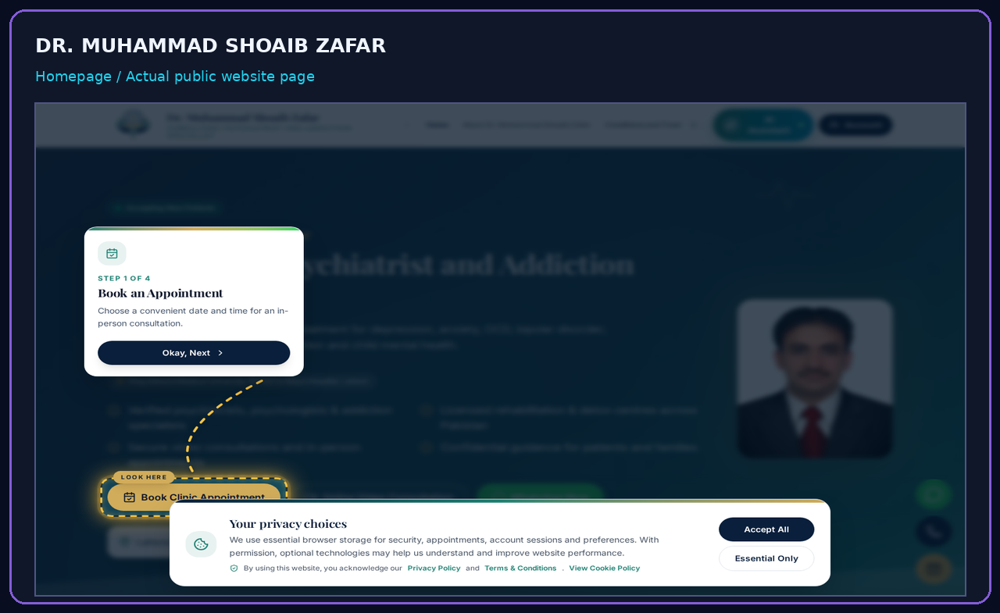 <b>Homepage</b> · Public webpage preview</td>
<td width="50%" align="center" valign="top">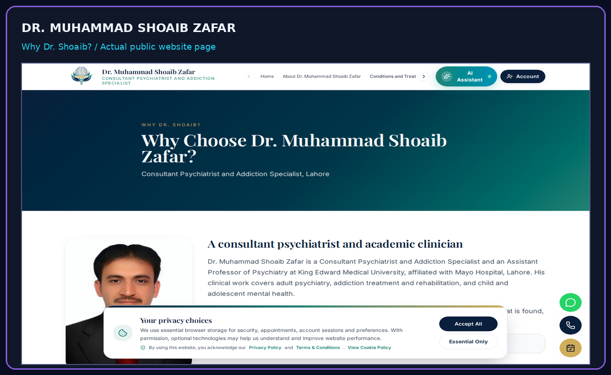 <b>Why Dr. Shoaib?</b> · Public webpage preview</td>
</tr>
<tr>
<td width="50%" align="center" valign="top">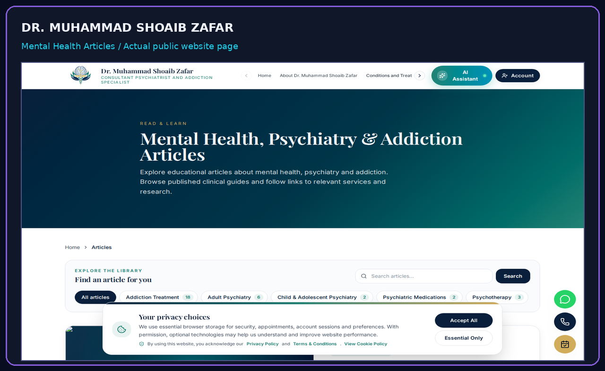 <b>Mental Health Articles</b> · Public webpage preview</td>
<td width="50%" align="center" valign="top">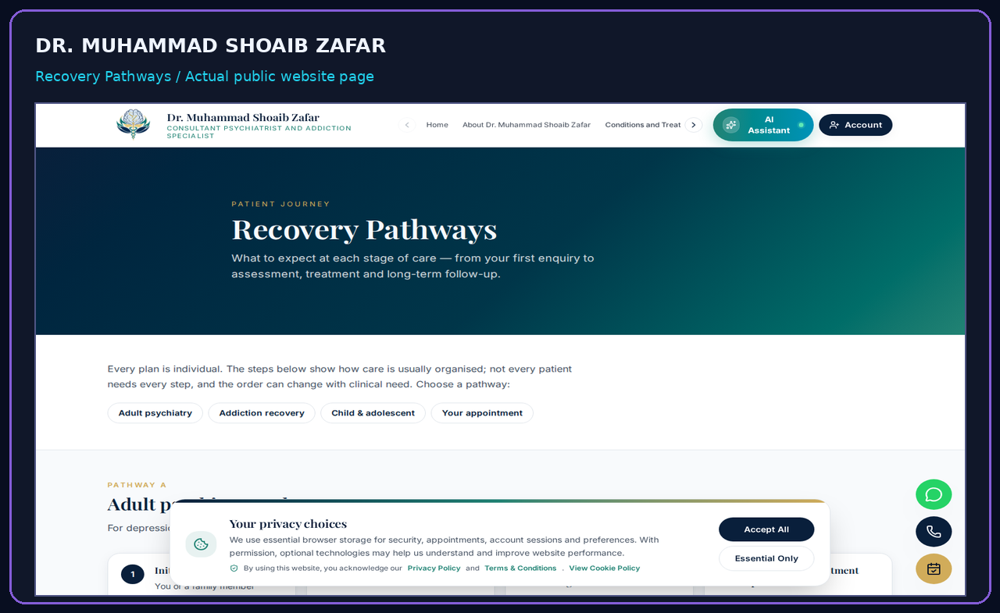 <b>Recovery Pathways</b> · Public webpage preview</td>
</tr>
<tr>
<td width="50%" align="center" valign="top">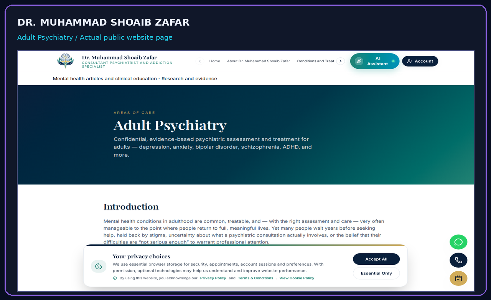 <b>Adult Psychiatry</b> · Public webpage preview</td>
<td width="50%" align="center" valign="top">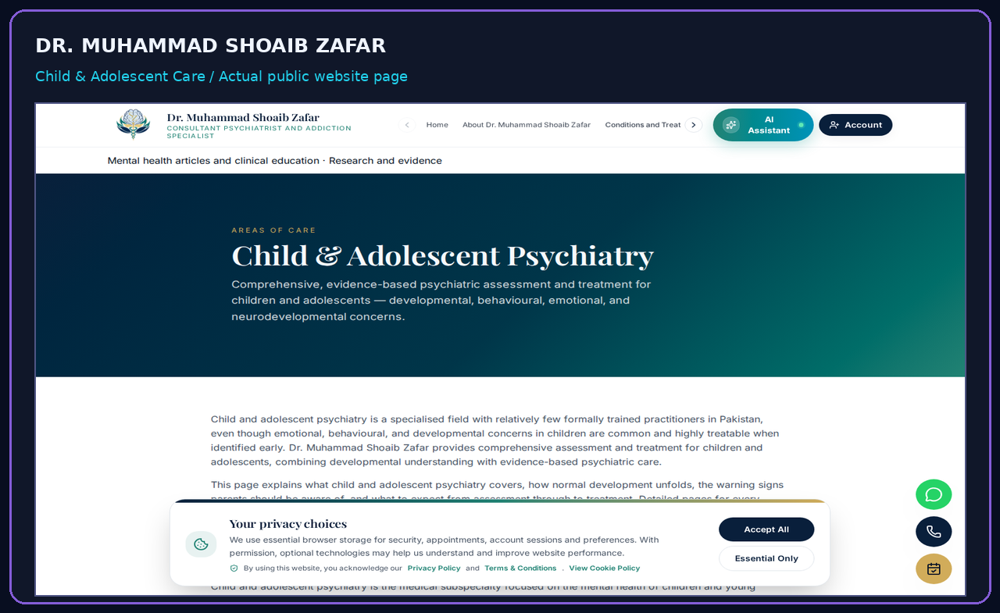 <b>Child &amp; Adolescent Care</b> · Public webpage preview</td>
</tr>
<tr>
<td width="50%" align="center" valign="top">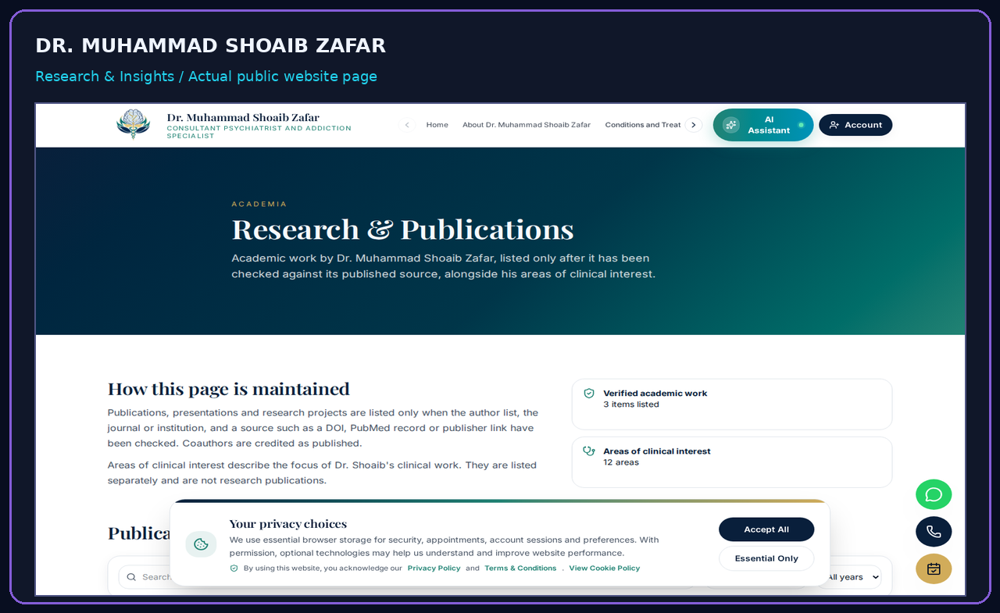 <b>Research &amp; Insights</b> · Public webpage preview</td>
<td width="50%" align="center" valign="top">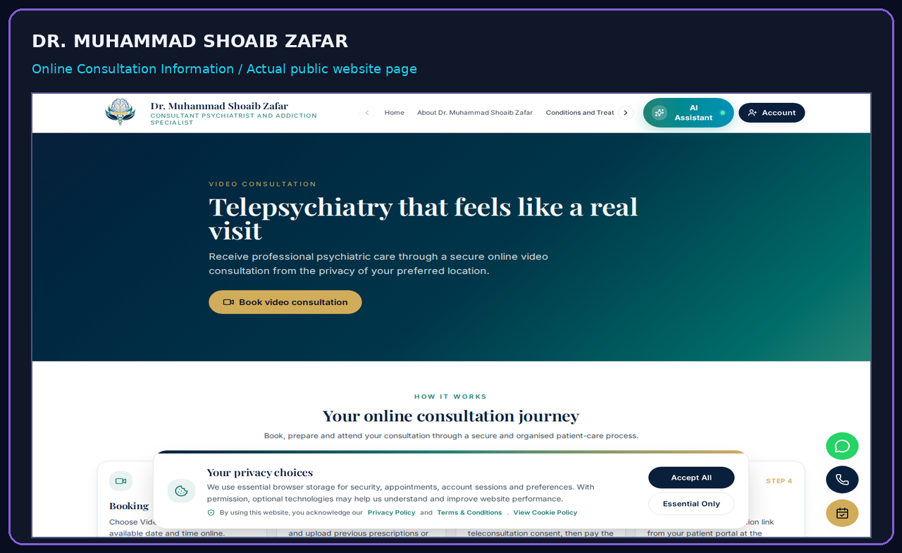 <b>Online Consultation Information</b> · Public webpage preview</td>
</tr>
<tr>
<td width="50%" align="center" valign="top">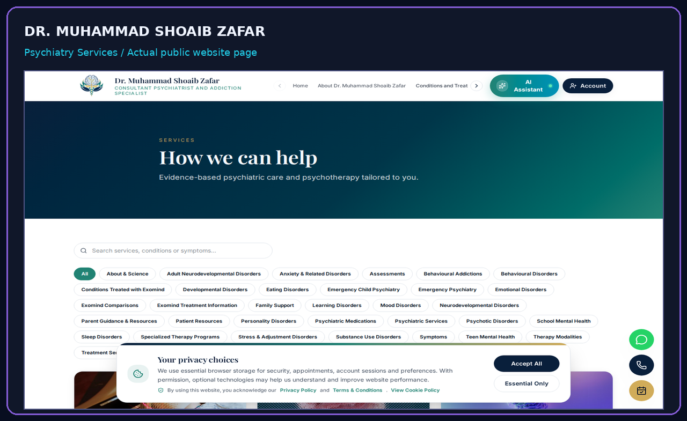 <b>Psychiatry Services</b> · Public webpage preview</td>
<td width="50%"></td>
</tr>
</table>

*Screenshot images are not website or source links. Only anonymous public pages are captured, never admin, private patient records or authenticated booking flows. The private source project and manually deployed production site are unchanged.*

<!-- REHABCONNECT-PUBLIC-PAGES:START -->
## RehabConnect — Healthcare Discovery & Facility Operations

**Platform type:** Healthcare Directory · Rehab Finder · Facility Operations

**Short description:** Find rehabilitation centres and mental-health professionals, compare services and access recovery resources.

**Project overview:** A multi-portal healthcare discovery and facility-operations platform. Public pages offer rehabilitation and professional directories, city/town search, centre comparisons and mental-health resources. Separate private tools support facility staff and admission workflows.

**PUBLIC EXPERIENCE · FEATURE BADGES**

<kbd>🏥 Rehab Centre Directory</kbd> <kbd>🩺 Professional Profiles</kbd> <kbd>🔎 Smart Care Finder</kbd> <kbd>📍 City & Town Filters</kbd> <kbd>⚖️ Centre Comparison</kbd> <kbd>🧭 Care Matcher</kbd> <kbd>📚 Recovery Resources</kbd> <kbd>🧪 Research & Insights</kbd> <kbd>👨‍👩‍👧 Family Support</kbd> <kbd>📝 Health Articles</kbd> <kbd>🏢 Facility Onboarding</kbd> <kbd>📅 Appointment Flows</kbd> <kbd>💻 Responsive Web Platform</kbd>

**FACILITY OPERATIONS · PRIVATE WORKFLOWS**

<kbd>🔐 Role-Based Admin</kbd> <kbd>🛏️ Inpatient Management</kbd> <kbd>📊 Facility Reporting</kbd> <kbd>👥 Staff Portals</kbd> <kbd>🗂️ Content Management</kbd>

**TECHNOLOGY STACK**

<kbd>React</kbd> <kbd>TypeScript</kbd> <kbd>TanStack Start</kbd> <kbd>Node.js</kbd> <kbd>Express</kbd> <kbd>MySQL</kbd> <kbd>Tailwind CSS</kbd>

*The public features reflect site pages; staff, admissions and operations functions are high-level capabilities found in the private application, not screenshots of live patient or administration data.*

**Website screenshot previews — no external redirects**

### Selected Public Website Pages

<table>
<tr>
<td align="center" valign="top" width="50%">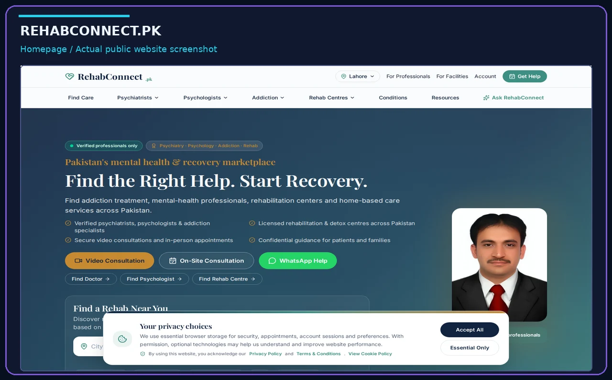<b>Homepage</b> · Public website screenshot</td>
<td align="center" valign="top" width="50%">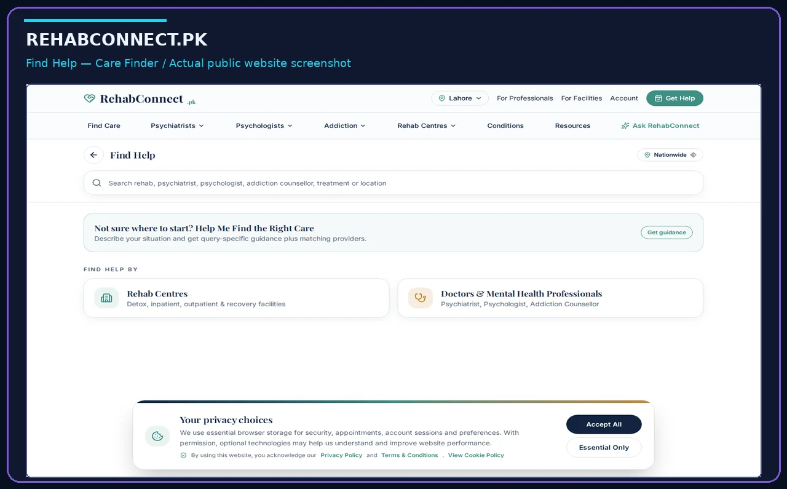<b>Find Help — Care Finder</b> · Public website screenshot</td>
</tr>
<tr>
<td align="center" valign="top" width="50%">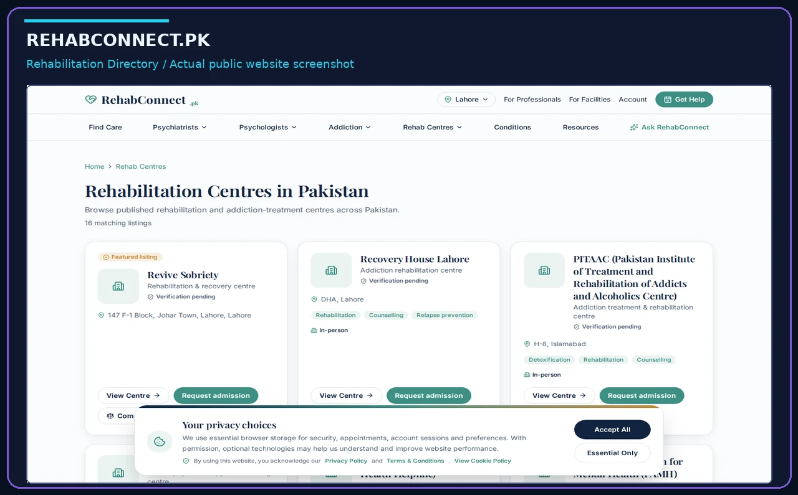<b>Rehabilitation Directory</b> · Public website screenshot</td>
<td align="center" valign="top" width="50%">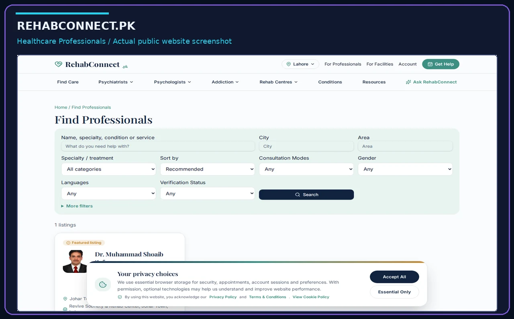<b>Healthcare Professionals</b> · Public website screenshot</td>
</tr>
<tr>
<td align="center" valign="top" width="50%">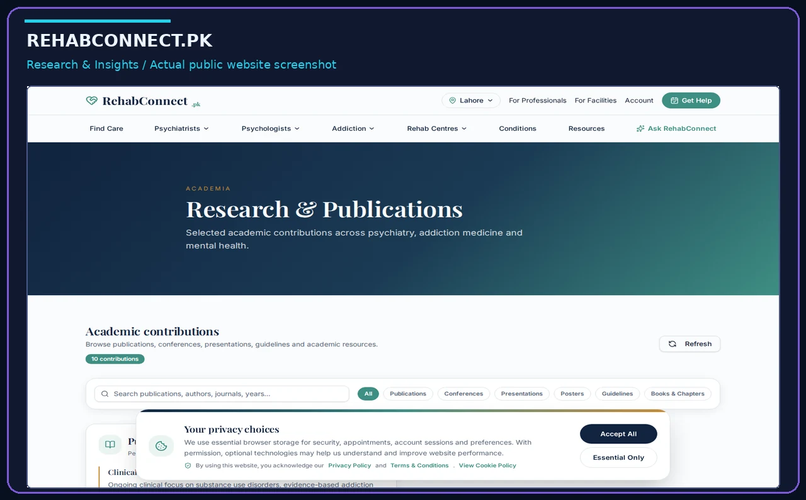<b>Research &amp; Insights</b> · Public website screenshot</td>
<td align="center" valign="top" width="50%">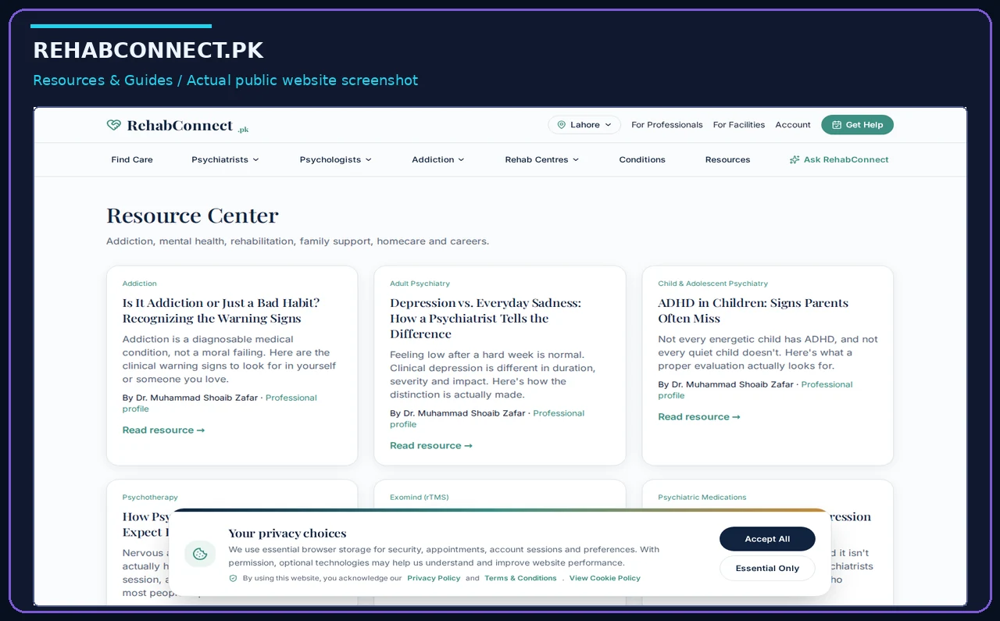<b>Resources &amp; Guides</b> · Public website screenshot</td>
</tr>
<tr>
<td align="center" valign="top" width="50%">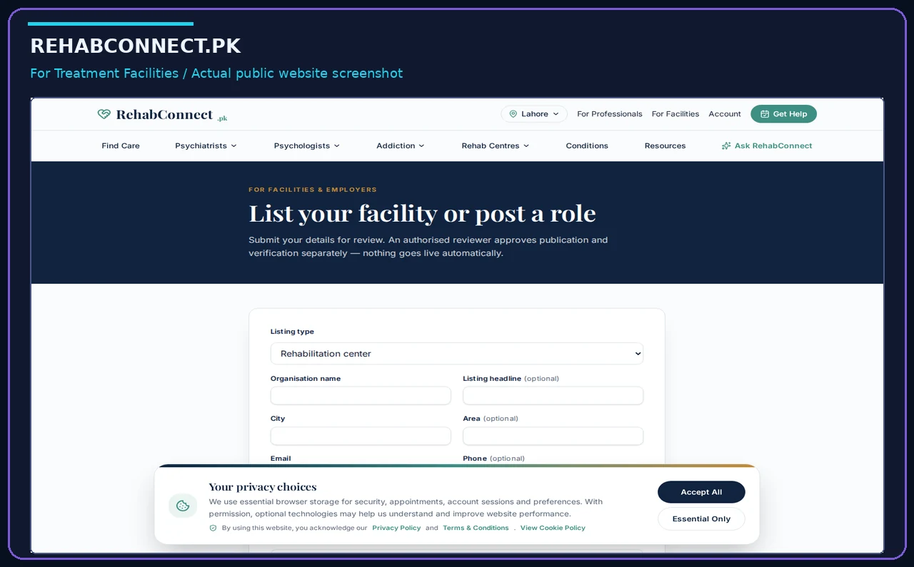<b>For Treatment Facilities</b> · Public website screenshot</td>
<td align="center" valign="top" width="50%">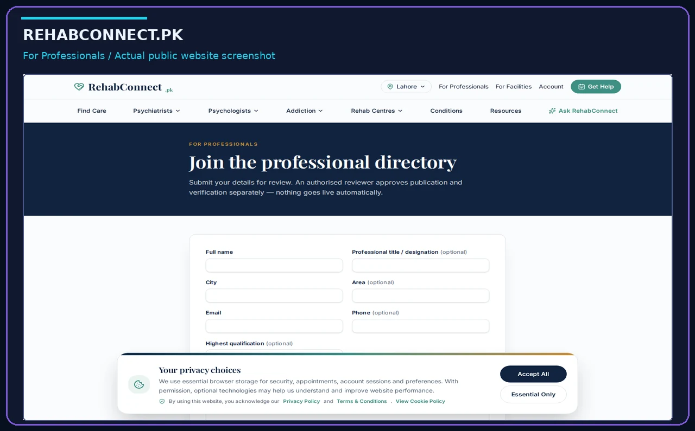<b>For Professionals</b> · Public website screenshot</td>
</tr>
<tr>
<td align="center" valign="top" width="50%">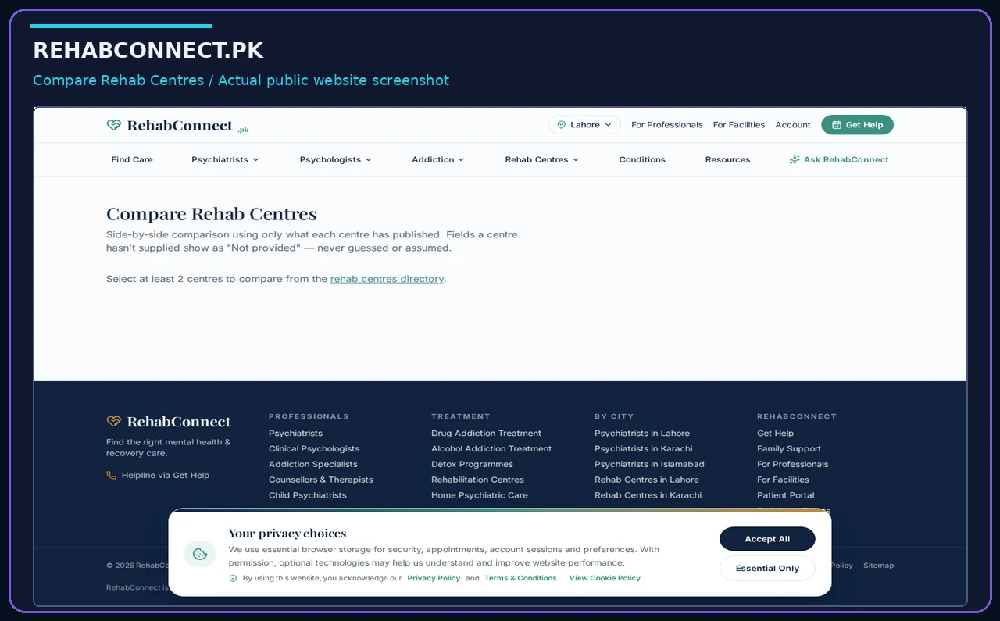<b>Compare Rehab Centres</b> · Public website screenshot</td>
<td align="center" valign="top" width="50%">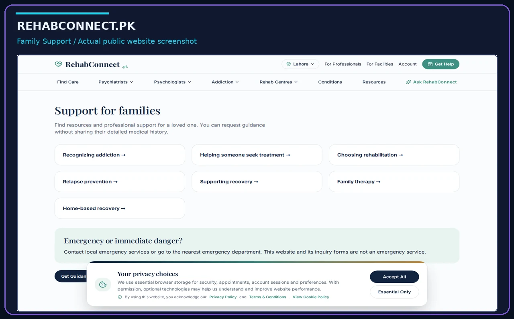<b>Family Support</b> · Public website screenshot</td>
</tr>
</table>

*Only approved, anonymous public-facing website pages are captured. No patient portal, staff dashboard, forms or private data are included. The screenshots refresh weekly; live pages can change between captures. Features are project capabilities, not claims of external clinical verification.*
<!-- REHABCONNECT-PUBLIC-PAGES:END -->

<!-- HADIA-COLLECTION-PUBLIC-PAGES:START -->
## Hadia Collection — Fashion E-Commerce Website

These are screenshots from the **actual publicly accessible website**, not illustrative dashboards. **Preview images are not links** to the website or the private GitHub source repository.

**Landing page and selected public screens**

**Project type:** Fashion E-Commerce Website · Online Store · Product Catalog

**Short description:** Fashion collections, new arrivals and customer-focused shopping.

**Implemented features (per the project repository):** 🛍️ Collections · ✨ New Arrivals · 🔎 Search · 🎛️ Filters · 📦 Size/Color Selection · 🛒 Cart · 💵 COD Checkout · 🚚 Tracking · 👤 Accounts · ⭐ Reviews · 🔄 Returns · 🔔 Real-Time Order Updates.

**Technology stack:** `Node.js` · `Express` · `EJS` · `JavaScript` · `MySQL` · `Socket.IO`

**Note:** Screenshots document public website appearance; implementation features above come from the private source's public-safe feature inventory.

### Selected website pages

<table>
<tr>
<td align="center" valign="top" width="50%"><b>Shop Homepage</b> · Public website screenshot</td>
<td align="center" valign="top" width="50%">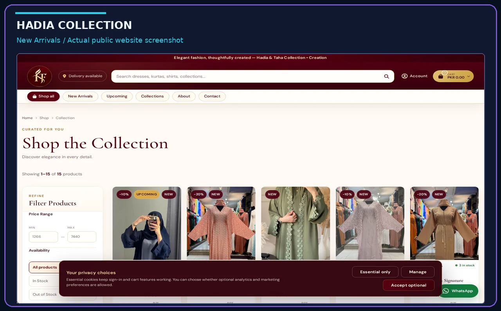<b>New Arrivals</b> · Public website screenshot</td>
</tr>
<tr>
<td align="center" valign="top" width="50%">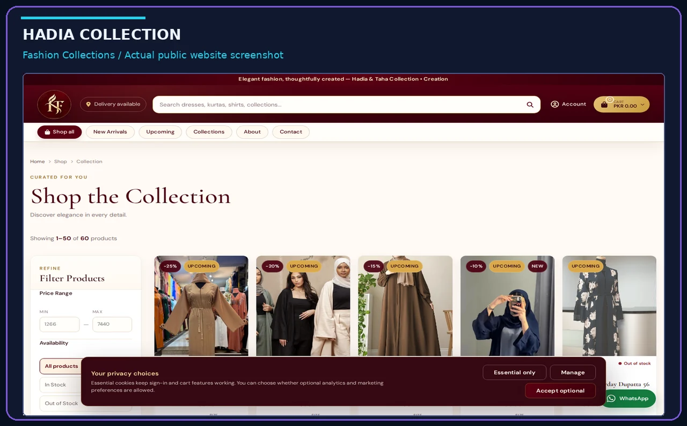<b>Fashion Collections</b> · Public website screenshot</td>
<td align="center" valign="top" width="50%">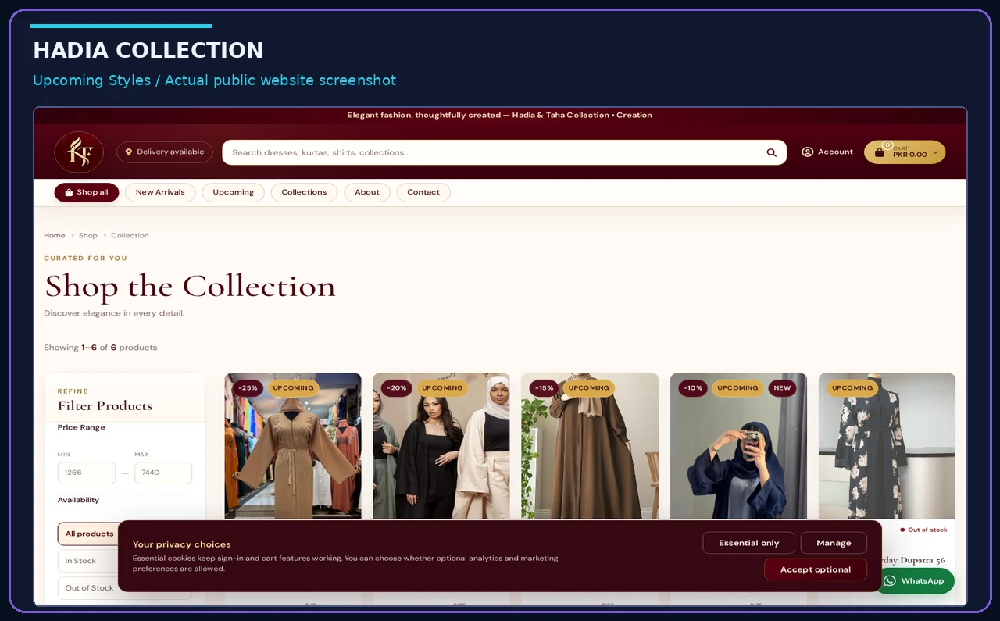<b>Upcoming Styles</b> · Public website screenshot</td>
</tr>
<tr>
<td align="center" valign="top" width="50%">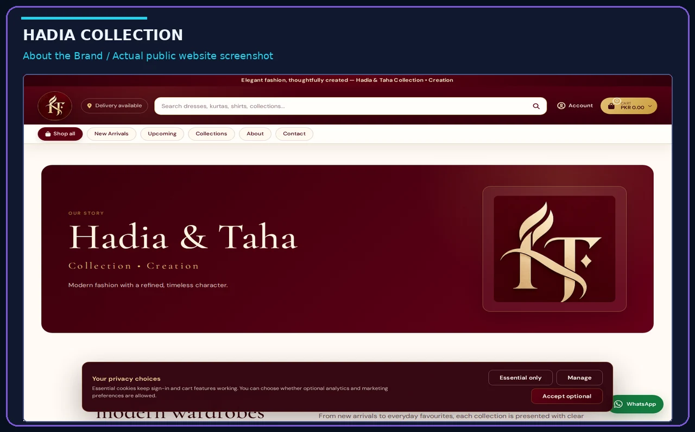<b>About the Brand</b> · Public website screenshot</td>
<td align="center" valign="top" width="50%">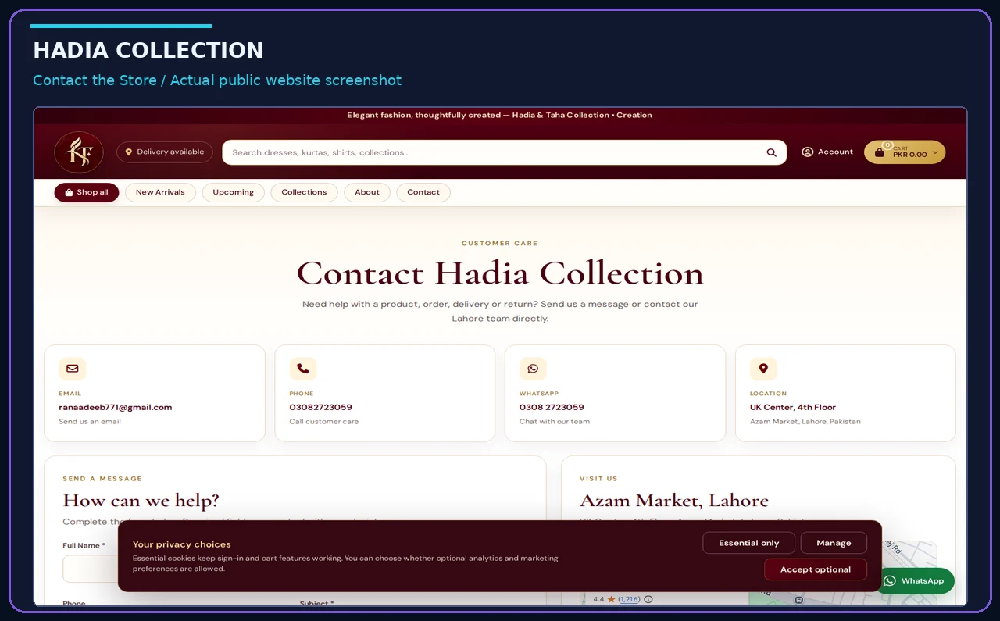<b>Contact the Store</b> · Public website screenshot</td>
</tr>
<tr>
<td align="center" valign="top" width="50%">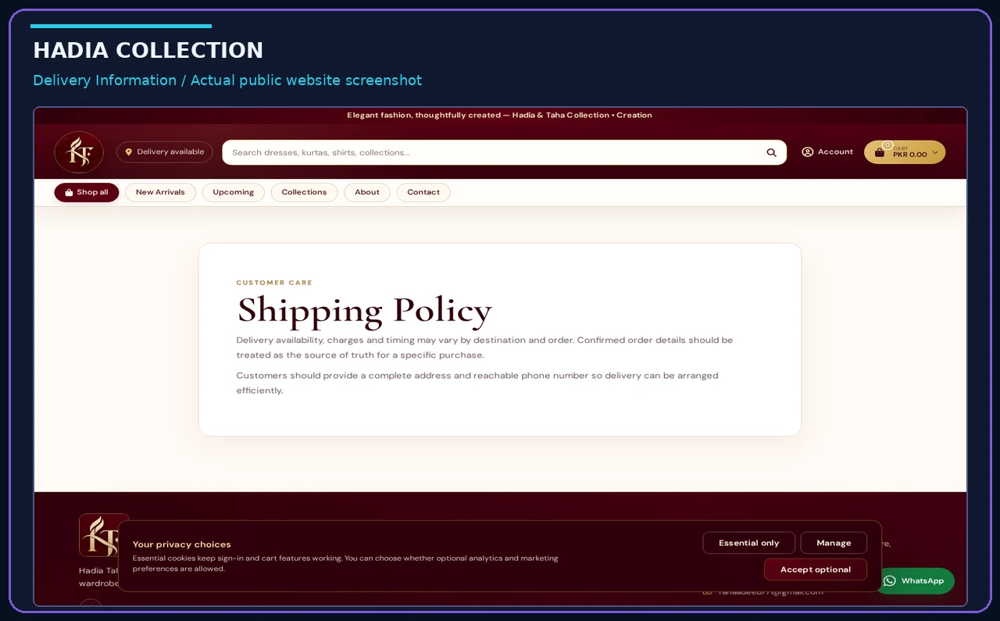<b>Delivery Information</b> · Public website screenshot</td>
<td width="50%"></td>
</tr>
</table>

*Only approved, anonymous public-facing website pages are captured. No customer account, checkout, admin or order details are included. The screenshots refresh weekly; live pages can change between captures.*
<!-- HADIA-COLLECTION-PUBLIC-PAGES:END -->

<!-- DR-SHOAIB-PUBLIC-PAGES:START -->
## Dr. Muhammad Shoaib Zafar — Psychiatry Website & Clinic System

**Platform type:** Psychiatry Clinic Website · CMS · Patient Services

**Short description:** Professional psychiatry website with care pathways, appointment access, specialist information and educational resources.

**Project overview:** A multi-module psychiatry website and clinic system with public mental-health content, adult and child psychiatry pathways, recovery guidance, telepsychiatry information, research and articles. The private application also includes editorial, patient and clinic-management tools.

**PUBLIC WEBSITE · FEATURE BADGES**

<kbd>👨‍⚕️ Doctor Profile</kbd> <kbd>🧠 Adult Psychiatry</kbd> <kbd>🧒 Child & Adolescent Care</kbd> <kbd>🧭 Recovery Pathways</kbd> <kbd>🧩 Addiction Information</kbd> <kbd>💬 Psychotherapy Services</kbd> <kbd>💻 Telepsychiatry</kbd> <kbd>📰 Mental-Health Articles</kbd> <kbd>🔬 Research & Insights</kbd> <kbd>📅 Appointment Access</kbd> <kbd>📚 Treatment Information</kbd> <kbd>🔎 Service Discovery</kbd> <kbd>📱 Responsive Website</kbd>

**PRIVATE APPLICATION · CLINIC / CMS CAPABILITIES**

<kbd>📝 Content Management</kbd> <kbd>✅ Editorial Review</kbd> <kbd>👤 Patient Portal</kbd> <kbd>👩‍⚕️ Doctor Portal</kbd> <kbd>🏥 Clinic Administration</kbd> <kbd>📦 MediStock / Inventory</kbd> <kbd>🔐 Role-Based Access</kbd>

**TECHNOLOGY STACK**

<kbd>React</kbd> <kbd>TypeScript</kbd> <kbd>TanStack Start</kbd> <kbd>Node.js</kbd> <kbd>Express</kbd> <kbd>MySQL</kbd> <kbd>Tailwind CSS</kbd>

*Public website pages and private codebase capabilities are shown separately. Private modules are not represented as live public screenshots or as clinically approved functions.*

### Genuine Public Website Preview

### Selected Public Pages

<table>
<tr>
<td width="50%" align="center" valign="top"> <b>Homepage</b> · Public webpage preview</td>
<td width="50%" align="center" valign="top"> <b>Why Dr. Shoaib?</b> · Public webpage preview</td>
</tr>
<tr>
<td width="50%" align="center" valign="top"> <b>Mental Health Articles</b> · Public webpage preview</td>
<td width="50%" align="center" valign="top"> <b>Recovery Pathways</b> · Public webpage preview</td>
</tr>
<tr>
<td width="50%" align="center" valign="top"> <b>Adult Psychiatry</b> · Public webpage preview</td>
<td width="50%" align="center" valign="top"> <b>Child &amp; Adolescent Care</b> · Public webpage preview</td>
</tr>
<tr>
<td width="50%" align="center" valign="top"> <b>Research &amp; Insights</b> · Public webpage preview</td>
<td width="50%" align="center" valign="top"> <b>Online Consultation Information</b> · Public webpage preview</td>
</tr>
<tr>
<td width="50%" align="center" valign="top"> <b>Psychiatry Services</b> · Public webpage preview</td>
<td width="50%"></td>
</tr>
</table>

*Screenshot images are not website or source links. Only anonymous public pages are captured, never admin, private patient records or authenticated booking flows. The private source project and manually deployed production site are unchanged.*

## Source code, examples and confidentiality

- **Private-source projects:** All application repositories currently reviewed are private. Public-facing graphics are high-level **illustrative design concepts**, not live screenshots or proof of every feature.
- **Public source links:** We do not expose direct links to private application repositories. The GitHub profile repository is public so that visitors can view the professional README.
- **Live demos:** Existing public demos or separate application hosting are required; visual project concepts do not function as live demos.
- **Automatic repository discovery:** New *public* repositories are showcased by GitHub Actions. New *private* projects require an explicit public-safe approval entry, and source code stays private.
- **Genuine activity:** GitHub's native contribution calendar is authoritative; a dated contribution screenshot is not a live counter.

[**Review our enterprise service offerings →**](./SERVICES.md) · [**Technology matrix →**](./TECHNOLOGY_STACK.md)

*Please contact us for a tailored technical review and relevant work samples. We do not publish confidential client assets or repository contents.*
