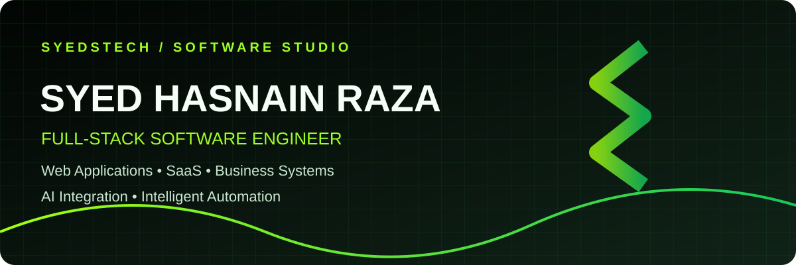

### Full-Stack Software Engineer · Founder, SyedsTech

**Custom Web Applications · Business Software · SaaS · AI Integration & Automation**

Building practical, secure and scalable software for startups and businesses.

[**Discuss a Project**](mailto:razahasnain0300@gmail.com?subject=Software%20Project%20Enquiry) · [**Selected Work**](#selected-work) · [**SyedsTech Organization**](https://github.com/Syeds-Tech00)

---

## What I build

| Digital products | Business systems | Intelligent integrations |
|---|---|---|
| Custom websites, web apps, SaaS platforms | E-commerce, inventory, CRM, dashboards | REST APIs, workflow automation, AI integrations |

I work across frontend interfaces, backend services, databases and deployment. My approach prioritizes maintainability, responsive design, data integrity and real business workflows.

## Core technology stack

**Frontend:** JavaScript, TypeScript, React, Next.js, HTML, CSS, Bootstrap, Three.js  
**Backend:** PHP, Node.js, Express, Python, Django, REST APIs  
**Data:** MySQL, PostgreSQL, Supabase, SQL Server  
**Workflow:** Git, GitHub, API testing, automation and AI-assisted development

*Technology choices vary by project; this is not a claim of equal proficiency in every tool.*

## Selected work

> Project source repositories are private. These are high-level case studies, not public code demos. Screenshots and live links are included only where available and appropriate.

### RehabConnect Pakistan — Healthcare discovery platform
A patient-facing healthcare and rehabilitation directory featuring professional discovery, treatment-center listings, location-based exploration, educational resources and responsive navigation.

[Explore the public website](https://rehabconnect.pk)

### GOEV Pakistan — Electric mobility platform
An electric-vehicle marketplace project with public discovery, seller and administrative experiences, variant management and API-backed workflows. **Status:** some integrations remain under development/testing.

### Kanz Store — E-commerce operations
A retail platform covering product variants, inventory, carts, orders and return workflows. Specific deployment and feature readiness should be verified before public claims.

### MedBoostPro — Education technology
An education platform architecture spanning public, student and administrator interfaces with a shared backend API. **Status:** production runtime readiness should be verified separately.

### Dr. Shoaib Zafar — Specialist platform
A professional website and clinic-management ecosystem with research content and administrative modules. Clinical content and production-release items require review.

### Amaken Real Estate — Property website
A property-focused web experience using PHP, PDO, MySQL and responsive Bootstrap layouts.

<b>More project categories</b>

Real estate dashboards · Business management · Marketplace interfaces · Interactive business cards · Contracting websites · Desktop AI assistant concepts · Retail storefronts.

Additional project details are available upon request, subject to client confidentiality.

## How I work

**Discover → Design → Develop → Integrate → Test → Deliver**

I translate business needs into clear features, connected workflows, secure data handling and maintainable code. I focus on real use cases, responsive interfaces and dependable application behavior.

## GitHub activity

Contribution animation

## Public repositories — automatically updated

<!-- AUTO-PUBLIC-PROJECTS:START -->
**0 public project repositories** are currently discoverable. This list is automatically refreshed from GitHub repository metadata. Private project showcases above are curated separately and remain source-code protected.

No public project repositories are currently available.

**Need a similar project?** [WhatsApp Pakistan](https://wa.me/923065967478) · [WhatsApp UAE](https://wa.me/971552615993) · [Email](mailto:razahasnain0300@gmail.com)
<!-- AUTO-PUBLIC-PROJECTS:END -->

## Let's build something useful

Need a custom website, business platform, SaaS application, or AI-enabled workflow? Share the business problem, must-have features, expected users and timeline.

**[Email a project enquiry](mailto:razahasnain0300@gmail.com?subject=Software%20Project%20Enquiry)** · **[WhatsApp Pakistan](https://wa.me/923065967478)** · **[WhatsApp UAE](https://wa.me/971552615993)**

SyedsTech · Lahore, Pakistan · Remote collaboration worldwide

