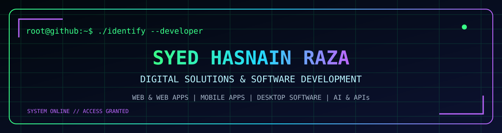
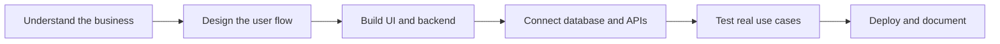

<div align="center">



### SYEDS TECH · Full-Service Software Development Team

**Websites · Web Apps · SaaS · Desktop Software · Android · iOS · AI & Automation**


<br />

<a href="https://wa.me/923065967478?text=Hello%20Syeds%20Tech%2C%20I%20would%20like%20to%20discuss%20a%20software%20development%20project."></a>
<a href="mailto:razahasnain0300@gmail.com"></a>
<a href="https://wa.me/971552615993?text=Hello%20Syeds%20Tech%2C%20I%20would%20like%20to%20discuss%20a%20software%20development%20project."></a>

<br />


<sub>One animated portrait, a clean layout, and a focus on real-world solutions.</sub>

**[Team](#-our-development-team)** · **[Languages](#-programming-languages)** · **[About](#-about-me)** · **[Solutions](#-what-i-build)** · **[Projects](#-private-project-portfolio--features--technology)** · **[Tech](#-frameworks-tools--technology-stack)** · **[Workflow](#-how-i-deliver)** · **[Activity](#-github-activity)** · **[Contact](#-work-with-me)**

</div>

---

## 👥 Our development team

**Syeds Tech** presents a collaborative, multidisciplinary approach to delivering complete digital products. The roles below describe the disciplines involved in a full project delivery—not a verified public employee roster.

| Team / discipline | Focus |
|:---|:---|
| 🎨 **UI/UX & Product Design** | Research, wireframes, visual design, responsive experiences |
| 🌐 **Frontend Development** | Websites, web apps, interactive interfaces |
| ⚙️ **Backend & API Development** | Business logic, integrations, authentication, services |
| 📱 **Android & iOS Development** | Native and cross-platform mobile solutions |
| 🖥️ **Desktop & Business Software** | POS, ERP, CRM, inventory, custom desktop workflows |
| 🗄️ **Database & Architecture** | Relational design, data modeling, performance |
| 🤖 **AI & Automation** | AI-enabled features, integrations, workflow automation |
| 🧪 **QA, DevOps & Delivery** | Testing, deployment, monitoring and maintenance |

<div align="center">

[**Syeds Tech GitHub Organization**](https://github.com/Syeds-Tech00)

</div>

## 💻 Programming languages

A wide language ecosystem for different project types. **Listed languages represent our service and technology scope, not verified equal proficiency or a claim that every language is used on every project.**

**Web & scripting:** JavaScript · TypeScript · PHP · Python · Ruby · Perl · Lua · Bash · PowerShell

**Application & systems:** Java · C# · C · C++ · Go · Rust · Kotlin · Swift · Dart · Objective-C · Visual Basic .NET

**Data & analytics:** SQL · R · MATLAB · Julia

**Web markup & styling:** HTML5 · CSS3 · Sass · Less · XML · JSON

<div align="center">


</div>

## 👨‍💻 About me

I'm **Syed Hasnain Raza**, with **4+ years of web development experience**. I represent the Syeds Tech software development offering, bringing together the disciplines needed for end-to-end digital projects. I work on responsive interfaces, backend business rules, APIs, and relational databases.

My core hands-on technologies are **PHP, MySQL/MariaDB, JavaScript, HTML, CSS, and Bootstrap**. I enjoy connecting the full experience—from a customer's first click to an administrator's daily operations.

Our project approach is to turn workflows into maintainable software, with particular interest in **e-commerce, booking portals, inventory, reporting, customer management, and custom dashboards**.

```text
$ whoami
  Syed Hasnain Raza | Full-stack web developer

$ focus
  Useful products > unnecessary complexity
  Clear user journeys > disconnected screens
  Reliable data flows > impressive-looking demos
```

## 🚀 What I build

| Solution | Examples of work |
| --- | --- |
| 🌐 **Business websites** | Company websites, landing pages, portfolios, real-estate experiences |
| 🧩 **Web applications** | Admin dashboards, CRM tools, customer portals, SaaS-style systems |
| 🛒 **E-commerce & marketplaces** | Catalogs, carts, checkout journeys, vendor portals, stock management |
| 📅 **Booking & service platforms** | Reservations, order tracking, schedules, messaging, payments |
| 📦 **Inventory & operations** | Purchases, sales, ledger flows, stock visibility, reporting |
| 🔗 **Backends & integrations** | REST APIs, authentication, relational data, service integration |
| 🖥️ **Desktop solutions** | Business tooling and POS-style application projects |
| 📱 **Mobile solutions** | Android, iOS, cross-platform and progressive web app project scope |

> **Private-code policy:** Project source code and downloadable packages are not offered through this portfolio. For a similar feature or custom build, contact us via WhatsApp.

## 🔒 Private project portfolio — features & technology

**Our source repositories are private.** These project summaries share high-level purposes, technology stacks and documented functionality—not code, downloadable packages or private credentials. Feature descriptions are based on project documentation; they are not a guarantee that every feature is live in production.

Interested in a similar website, web app, Android/iOS app or custom software? Use the project-specific **Request on WhatsApp** link below. It opens a prefilled enquiry for **+971 55 261 5993**.

### 01 · GOEV Pakistan

**Purpose:** Electric-vehicle marketplace and ecosystem platform.

**Technologies:** TypeScript · React · TanStack Start · Tailwind CSS · Node.js · Express · PostgreSQL/Supabase.

**Documented features / scope:** Public browsing, customer and seller portals, admin operations, charging and services architecture.

[**💬 Request a similar GOEV Pakistan project on WhatsApp**](https://wa.me/971552615993?text=Hello%20Syeds%20Tech%2C%20I%20am%20interested%20in%20a%20similar%20project%20to%20GOEV%20Pakistan.%20Please%20share%20features%2C%20pricing%20and%20development%20details.)

---

### 02 · MedBoostPro

**Purpose:** Education platform with separated public, student and admin experiences.

**Technologies:** React · TanStack Start · Vite · Node.js · Express.

**Documented features / scope:** Student-facing application, admin management, shared API, independently built application surfaces.

[**💬 Request a similar MedBoostPro project on WhatsApp**](https://wa.me/971552615993?text=Hello%20Syeds%20Tech%2C%20I%20am%20interested%20in%20a%20similar%20project%20to%20MedBoostPro.%20Please%20share%20features%2C%20pricing%20and%20development%20details.)

---

### 03 · Kanz Store

**Purpose:** Multi-category online store and retail operations platform.

**Technologies:** Node.js · Express · MySQL · Socket.IO · JavaScript.

**Documented features / scope:** Product variants, cart and checkout, inventory, order tracking, returns/refunds, customer accounts, real-time admin notifications.

[**💬 Request a similar Kanz Store project on WhatsApp**](https://wa.me/971552615993?text=Hello%20Syeds%20Tech%2C%20I%20am%20interested%20in%20a%20similar%20project%20to%20Kanz%20Store.%20Please%20share%20features%2C%20pricing%20and%20development%20details.)

---

### 04 · Dr. Shoaib Zafar

**Purpose:** Specialist website and clinic management ecosystem.

**Technologies:** React · Node.js · Express · MySQL.

**Documented features / scope:** Public professional website, administrative workspace, doctor portal, clinic inventory module; some content/release items pending review.

[**💬 Request a similar Dr. Shoaib Zafar project on WhatsApp**](https://wa.me/971552615993?text=Hello%20Syeds%20Tech%2C%20I%20am%20interested%20in%20a%20similar%20project%20to%20Dr.%20Shoaib%20Zafar.%20Please%20share%20features%2C%20pricing%20and%20development%20details.)

---

### 05 · Meem Connects

**Purpose:** Multi-vendor commerce project.

**Technologies:** TypeScript · React · TanStack Start · Tailwind CSS.

**Documented features / scope:** Marketplace-oriented interface foundation; detailed commerce workflows not independently verified.

[**💬 Request a similar Meem Connects project on WhatsApp**](https://wa.me/971552615993?text=Hello%20Syeds%20Tech%2C%20I%20am%20interested%20in%20a%20similar%20project%20to%20Meem%20Connects.%20Please%20share%20features%2C%20pricing%20and%20development%20details.)

---

### 06 · Amaken Real Estate

**Purpose:** Property and real-estate website.

**Technologies:** PHP · MySQL · PDO · Bootstrap.

**Documented features / scope:** Property-focused web experience, server-side database integration and contact configuration.

[**💬 Request a similar Amaken Real Estate project on WhatsApp**](https://wa.me/971552615993?text=Hello%20Syeds%20Tech%2C%20I%20am%20interested%20in%20a%20similar%20project%20to%20Amaken%20Real%20Estate.%20Please%20share%20features%2C%20pricing%20and%20development%20details.)

---

### 07 · rTMS Machine

**Purpose:** Neuromodulation-focused web project.

**Technologies:** TypeScript · React · TanStack Start · Tailwind CSS.

**Documented features / scope:** Web application foundation; specialized workflow implementation not independently verified.

[**💬 Request a similar rTMS Machine project on WhatsApp**](https://wa.me/971552615993?text=Hello%20Syeds%20Tech%2C%20I%20am%20interested%20in%20a%20similar%20project%20to%20rTMS%20Machine.%20Please%20share%20features%2C%20pricing%20and%20development%20details.)

---

### 08 · Syeds Tech Company Website

**Purpose:** IT services and digital agency website.

**Technologies:** TypeScript · React · TanStack Start · Tailwind CSS.

**Documented features / scope:** Business website foundation and service presentation; detailed features not independently verified.

[**💬 Request a similar Syeds Tech Company Website project on WhatsApp**](https://wa.me/971552615993?text=Hello%20Syeds%20Tech%2C%20I%20am%20interested%20in%20a%20similar%20project%20to%20Syeds%20Tech%20Company%20Website.%20Please%20share%20features%2C%20pricing%20and%20development%20details.)

---

<div align="center">

### Have a different project in mind?

**Websites · Web Apps · SaaS · E-commerce · ERP · CRM · POS · Android · iOS · Desktop · AI Integrations**

**WhatsApp UAE:** [+971 55 261 5993](https://wa.me/971552615993) · **WhatsApp Pakistan:** [+92 306 596 7478](https://wa.me/923065967478) · **Email:** [razahasnain0300@gmail.com](mailto:razahasnain0300@gmail.com)

[**💬 Discuss your custom project on WhatsApp**](https://wa.me/971552615993?text=Hello%20Syeds%20Tech%2C%20I%20would%20like%20to%20discuss%20a%20custom%20software%20development%20project.%20Please%20contact%20me.)

</div>

## 🧰 Frameworks, tools & technology stack

**Daily development stack**

<p>

</p>

**Additional platform and framework ecosystem**

I explore or work with technologies appropriate to project requirements; this is a technology overview, **not a claim of equal expertise across every language or platform**.

| Platform | Technologies to evaluate or use as suitable |
| --- | --- |
| Frontend | TypeScript, React, Next.js, Vue, Angular, Tailwind CSS |
| Backend | Node.js, Express, Laravel, Python, Django, FastAPI, ASP.NET |
| Mobile | Kotlin, Swift, Flutter, React Native, Dart |
| Desktop | .NET, Electron, Tauri, Qt |
| Data & delivery | PostgreSQL, SQLite, Docker, GitHub Actions, Linux, cloud hosting |
| Other languages | Java, C#, C/C++, Go, Rust, Ruby |

<details>
<summary><b>Explore the wider development ecosystem</b></summary>

<br />


</details>

## 🛠️ How I deliver



I favor usable interfaces, secure data handling, clear validation, role-based access where needed, and reproducible setups. Each project deserves attention to loading states, error handling, mobile responsiveness, and complete UI-to-database integration.

## 📈 GitHub activity

<div align="center">


<sub>Contribution visualization is generated by an existing GitHub Actions workflow.</sub>

<br /><br />


</div>

<details>
<summary><b>View contribution snake animation</b></summary>

<br />


</details>

## 🤝 Work with me

Need a **website, web app, admin system, API, e-commerce platform, or custom business solution**?

Tell us the problem, key features, expected users, platform, and timeline. We can discuss a suitable development plan. **Project enquiries:** WhatsApp UAE **+971 55 261 5993** · WhatsApp Pakistan **+92 306 596 7478** · Email **razahasnain0300@gmail.com**.

<div align="center">

<a href="mailto:razahasnain0300@gmail.com"></a>

<br /><br />

[**💬 Contact Syeds Tech on WhatsApp (UAE)**](https://wa.me/971552615993?text=Hello%20Syeds%20Tech%2C%20I%20would%20like%20to%20discuss%20a%20project.)

[**💬 WhatsApp Pakistan: +92 306 596 7478**](https://wa.me/923065967478?text=Hello%20Syeds%20Tech%2C%20I%20would%20like%20to%20discuss%20a%20software%20development%20project.) · [**✉ Email: razahasnain0300@gmail.com**](mailto:razahasnain0300@gmail.com)

<sub>© Syed Hasnain Raza · Websites · Web applications · Mobile apps · Desktop software · Business systems</sub>

</div>
