


### FULL-STACK SOFTWARE ENGINEER · FOUNDER, SYEDSTECH

**Custom Web Apps · Business Software · SaaS · AI Integration & Automation**

---

## 01 / About & Services

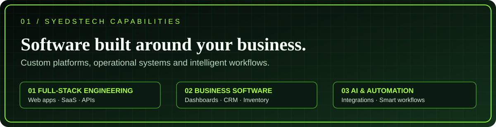

> **Engineering digital products that solve business problems.** Custom software, modern web platforms and intelligent automation. Based in Lahore, Pakistan — available for remote collaboration worldwide.

### Services / At a glance

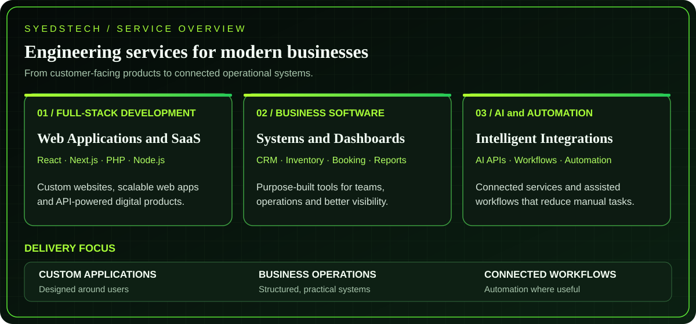

**Explore the service details below** to review scope, deliverables and implementation approach.

<b>01 / Full-Stack Engineering — View scope and deliverables</b>

**Build:** Custom websites, React/Next.js interfaces, PHP/Node.js backends, REST APIs, authentication and relational database applications.

**Typical handover:** User-facing application, administration features, technical documentation and deployment guidance, according to agreed scope.

<b>02 / Business Software — View scope and deliverables</b>

**Build:** Inventory systems, e-commerce workflows, CRM-style platforms, booking applications, dashboards and reports.

**Typical handover:** Permission-based workflows, structured data, operational screens and reporting tools.

<b>03 / AI Integration & Automation — View scope and deliverables</b>

**Build:** AI API integrations, connected workflows, data processing, intelligent search and third-party service integrations.

**Approach:** Privacy-aware design, error handling, appropriate human oversight and testing against real use cases.

**Have a product idea or an operational problem to solve?**

---

<table><tr><td width="100%" bgcolor="#07120B"><h2>02 / Engineering toolkit</h2>
SYEDSTECH / TECHNOLOGIES
</td></tr></table>

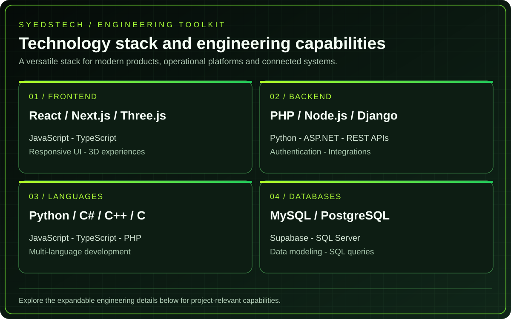

**Explore the engineering stack** using the expandable categories below.

<b>▸ Frontend Engineering — React, Next.js & Three.js</b>

JavaScript · TypeScript · React · Next.js · HTML5 · CSS3 · Bootstrap · jQuery · Three.js

Responsive layouts, component architecture, interactive interfaces and visual experiences.

<b>▸ Backend Engineering — PHP, Node.js, Django & ASP.NET</b>

PHP · Node.js · Express.js · Python · Django · ASP.NET · REST APIs · authentication · service integrations

Server-side logic, application architecture and API-backed workflows.

<b>▸ Databases & Infrastructure — MySQL, PostgreSQL & Supabase</b>

MySQL · PostgreSQL · Microsoft SQL Server · Supabase · schema design · SQL queries · database integration

<b>▸ Engineering Workflow — Git, Testing & Automation</b>

Git · GitHub · API testing · deployment · debugging · AI-assisted development · documentation

*Technology experience varies by project; this is not a claim of equal proficiency in every tool.*

---

<table><tr><td width="100%" bgcolor="#07120B"><h2>03 / Selected projects</h2>
SYEDSTECH / PROJECTS
</td></tr></table>

> Large visual project cards inspired by the reference video. Expand each case study for details. Private repositories stay private; availability and production readiness vary.

[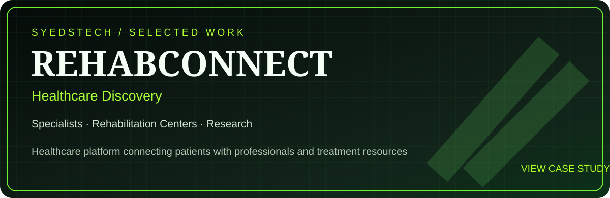](#case-rehabconnect)

<b>▸ Open RehabConnect Pakistan case study — Healthcare Technology</b>

> Healthcare and rehabilitation discovery platform for patients and professionals.

**Highlights:** specialist profiles, rehabilitation-center listings, location-based discovery, educational resources and responsive navigation.

[Visit RehabConnect Pakistan](https://rehabconnect.pk)

[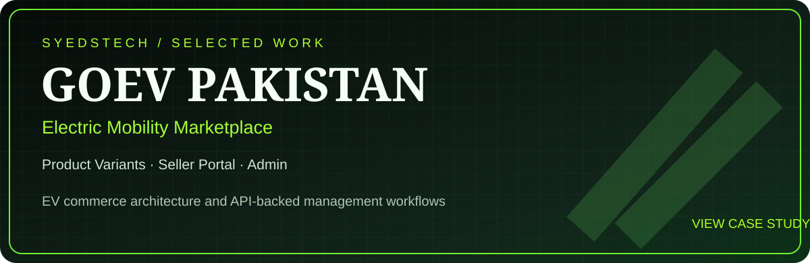](#case-goev)

<b>▸ Open GOEV Pakistan case study — Electric Mobility</b>

> Marketplace project supporting electric mobility product discovery.

**Highlights:** product variants, seller and administrative interfaces, API-backed workflows. **Status:** integrations under development/testing.

[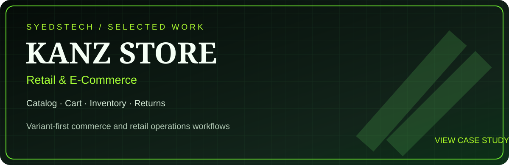](#case-kanz)

<b>▸ Open Kanz Store case study — E-Commerce</b>

> Retail application and business operations project.

**Highlights:** catalog, product variants, carts, orders, inventory and returns. Deployment and individual feature readiness should be verified.

[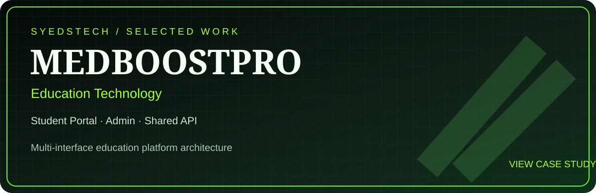](#case-medboost)

<b>▸ Open MedBoostPro case study — Education Technology</b>

> Multi-interface education platform architecture.

**Highlights:** public, student and administrator interfaces with a shared backend API. **Status:** production runtime readiness requires verification.

[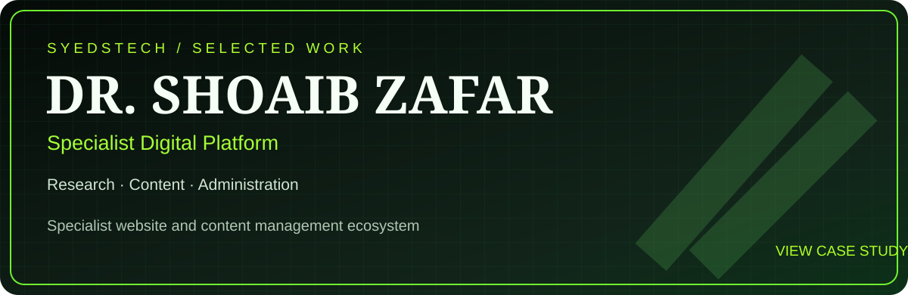](#case-shoaib)

<b>▸ Open Dr. Shoaib Zafar case study — Specialist Platform</b>

> Professional web presence with research and administrative components.

**Highlights:** research content, public pages and management modules. Clinical content and release status require review.

<b>LOAD MORE PROJECTS — Show projects 6–10 (click to expand)</b>

[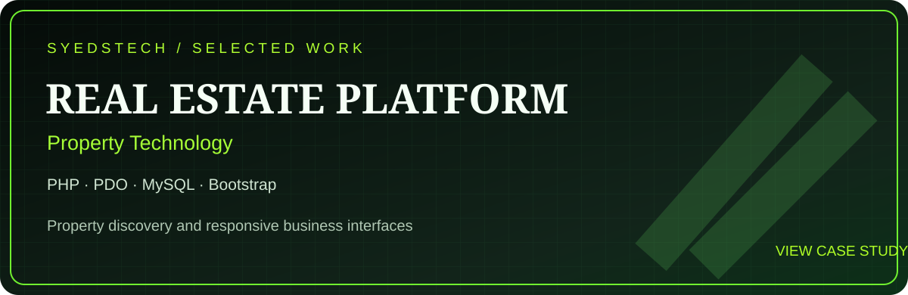](#case-realestate)

<b>▸ Open Amaken Real Estate case study — Property Technology</b>

> Property-focused web platform.

**Highlights:** PHP, PDO, MySQL and responsive Bootstrap property interfaces.

[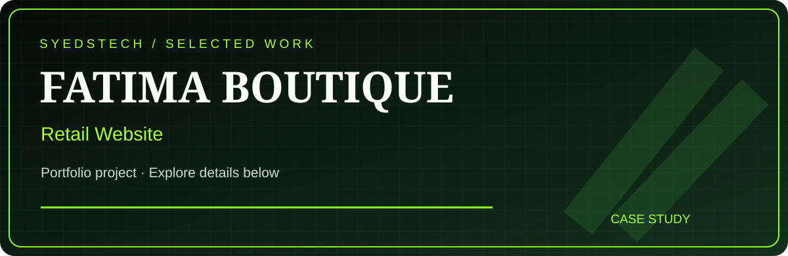](#project-fatima)

<b>▸ 07 / Fatima Boutique — Retail website</b>

> Project repository identified in the connected GitHub account. Scope, feature readiness and public deployment have not been verified.

**Portfolio details:** Screenshots and verified technical highlights can be added later without exposing private source code.

[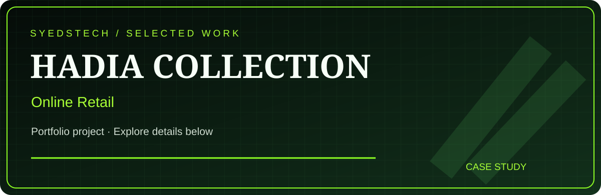](#project-hadia)

<b>▸ 08 / Hadia Collection — Online retail</b>

> Project repository identified in the connected GitHub account. Scope, feature readiness and public deployment have not been verified.

**Portfolio details:** Screenshots and verified technical highlights can be added later without exposing private source code.

[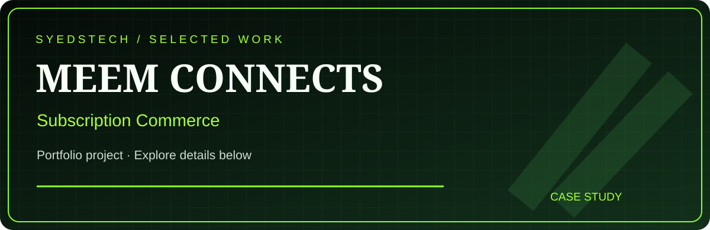](#project-meem)

<b>▸ 09 / Meem Connects — Subscription commerce</b>

> Project repository identified in the connected GitHub account. Scope, feature readiness and public deployment have not been verified.

**Portfolio details:** Screenshots and verified technical highlights can be added later without exposing private source code.

[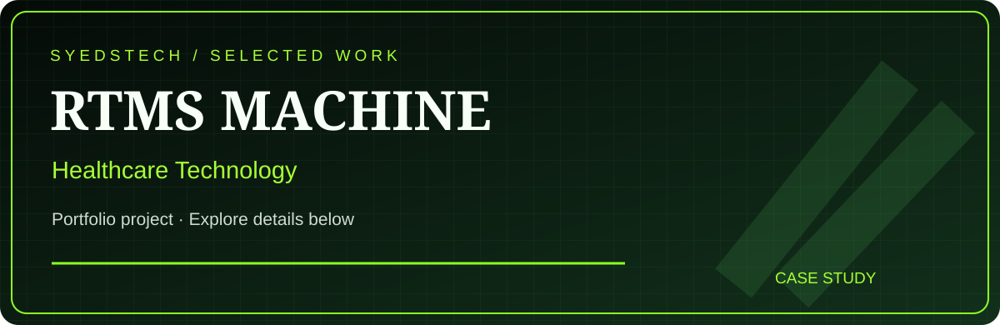](#project-rtms)

<b>▸ 10 / rTMS Machine — Healthcare technology</b>

> Project repository identified in the connected GitHub account. Scope, feature readiness and public deployment have not been verified.

**Portfolio details:** Screenshots and verified technical highlights can be added later without exposing private source code.

<b>LOAD MORE PROJECTS — Show projects 11–15 (click to expand)</b>

[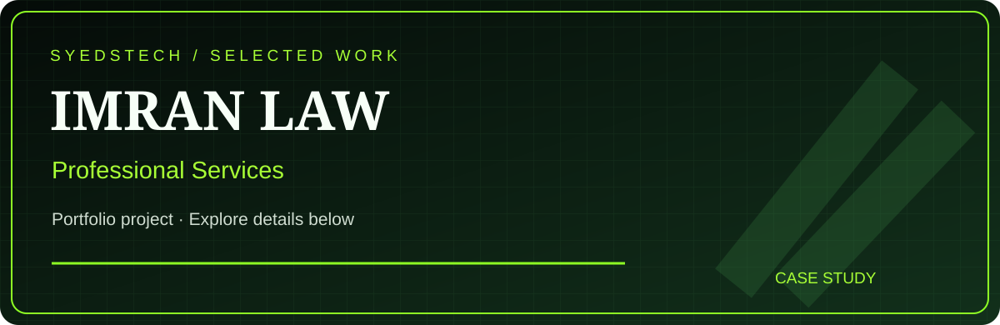](#project-imran)

<b>▸ 11 / Imran Law — Professional services</b>

> Project repository identified in the connected GitHub account. Scope, feature readiness and public deployment have not been verified.

**Portfolio details:** Screenshots and verified technical highlights can be added later without exposing private source code.

[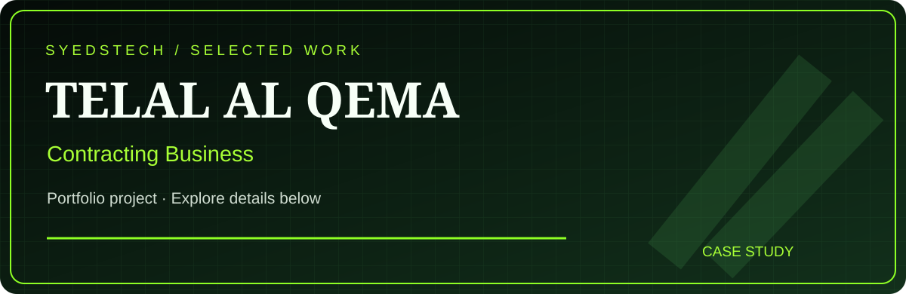](#project-telal)

<b>▸ 12 / Telal Al Qema Contracting — Contracting business</b>

> Project repository identified in the connected GitHub account. Scope, feature readiness and public deployment have not been verified.

**Portfolio details:** Screenshots and verified technical highlights can be added later without exposing private source code.

[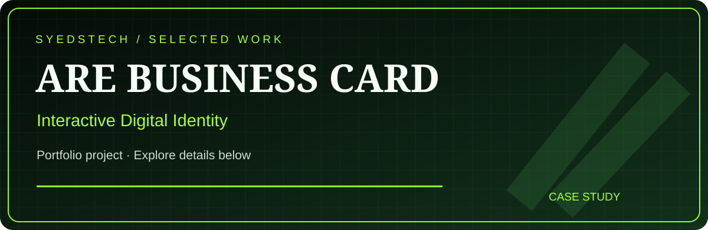](#project-are-card)

<b>▸ 13 / Interactive Business Card — ARE — Interactive digital identity</b>

> Project repository identified in the connected GitHub account. Scope, feature readiness and public deployment have not been verified.

**Portfolio details:** Screenshots and verified technical highlights can be added later without exposing private source code.

[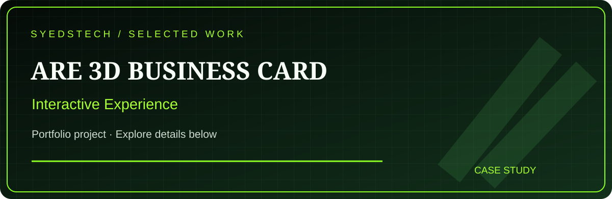](#project-are-3d)

<b>▸ 14 / 3D Interactive Business Card — ARE — Interactive experience</b>

> Project repository identified in the connected GitHub account. Scope, feature readiness and public deployment have not been verified.

**Portfolio details:** Screenshots and verified technical highlights can be added later without exposing private source code.

[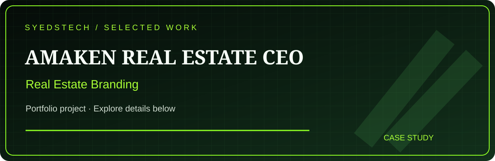](#project-amaken-ceo)

<b>▸ 15 / Amaken Real Estate CEO — Real estate branding</b>

> Project repository identified in the connected GitHub account. Scope, feature readiness and public deployment have not been verified.

**Portfolio details:** Screenshots and verified technical highlights can be added later without exposing private source code.

<b>LOAD MORE PROJECTS — Show projects 16–20 (click to expand)</b>

[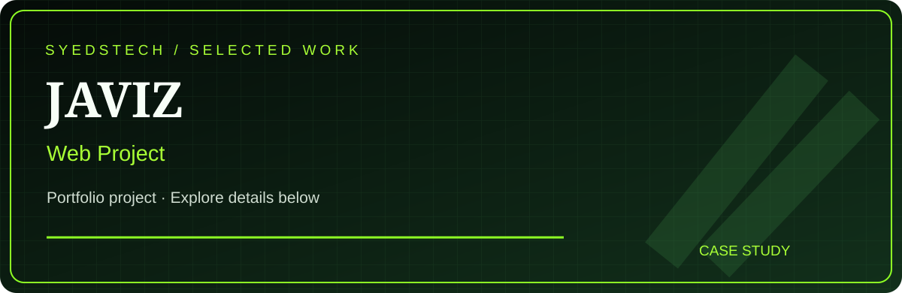](#project-javiz)

<b>▸ 16 / Javiz — Web project</b>

> Project repository identified in the connected GitHub account. Scope, feature readiness and public deployment have not been verified.

**Portfolio details:** Screenshots and verified technical highlights can be added later without exposing private source code.

[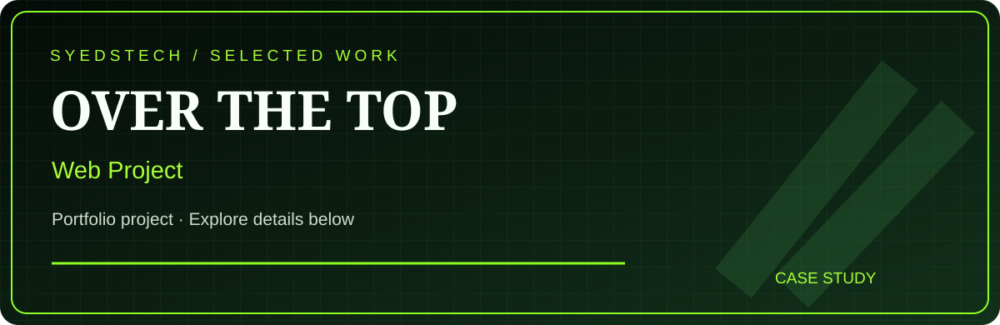](#project-overthetop)

<b>▸ 17 / Over The Top — Web project</b>

> Project repository identified in the connected GitHub account. Scope, feature readiness and public deployment have not been verified.

**Portfolio details:** Screenshots and verified technical highlights can be added later without exposing private source code.

[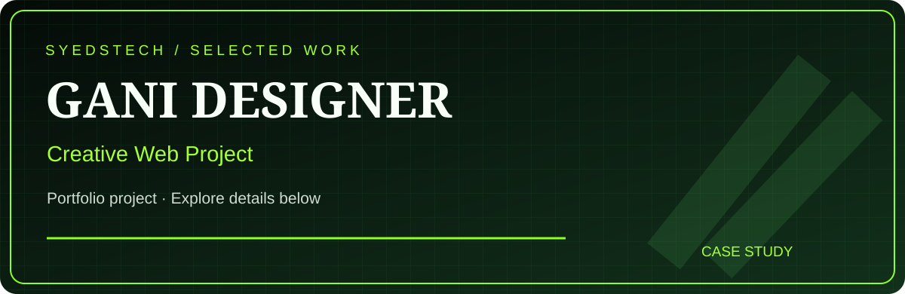](#project-gani)

<b>▸ 18 / Gani Designer — Creative web project</b>

> Project repository identified in the connected GitHub account. Scope, feature readiness and public deployment have not been verified.

**Portfolio details:** Screenshots and verified technical highlights can be added later without exposing private source code.

[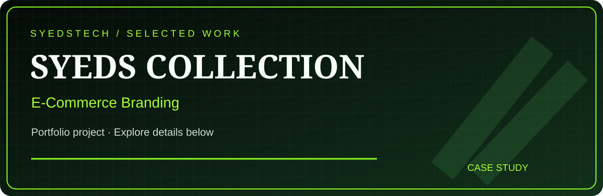](#project-syedscollection)

<b>▸ 19 / Syeds Collection — E-commerce branding</b>

> Project repository identified in the connected GitHub account. Scope, feature readiness and public deployment have not been verified.

**Portfolio details:** Screenshots and verified technical highlights can be added later without exposing private source code.

[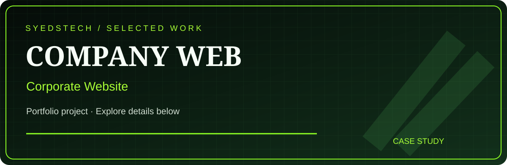](#project-companyweb)

<b>▸ 20 / Company Web — Corporate website</b>

> Project repository identified in the connected GitHub account. Scope, feature readiness and public deployment have not been verified.

**Portfolio details:** Screenshots and verified technical highlights can be added later without exposing private source code.

<b>All 20 portfolio entries are now shown.</b>

Additional entries are based on accessible repository names. No private code or private repository URLs are exposed. GitHub uses expandable groups rather than JavaScript pagination.

---

<table><tr><td width="100%" bgcolor="#07120B"><h2>04 / Delivery process</h2>
SYEDSTECH / PROCESS
</td></tr></table>

| DISCOVER | BUILD | DELIVER |
|:---:|:---:|:---:|
| Scope & architecture | UI · APIs · database | Integration · testing · release |

<b>▸ 01 — Discovery & Architecture</b>

Understand business goals, user roles, core workflows, integration requirements and delivery constraints.

<b>▸ 02 — Design & Development</b>

Build responsive interfaces, structured data models, backend services and clear user experiences.

<b>▸ 03 — Integration, Testing & Delivery</b>

Connect APIs, test important workflows, review security and reliability, and prepare the solution for deployment.

---

<table><tr><td width="100%" bgcolor="#07120B"><h2>05 / GitHub activity</h2>
SYEDSTECH / ACTIVITY
</td></tr></table>

| CONTRIBUTIONS | ANIMATION |
|:---:|:---:|
| 3D graph | Contribution snake |

<b>▸ 3D Contribution Visualization</b>

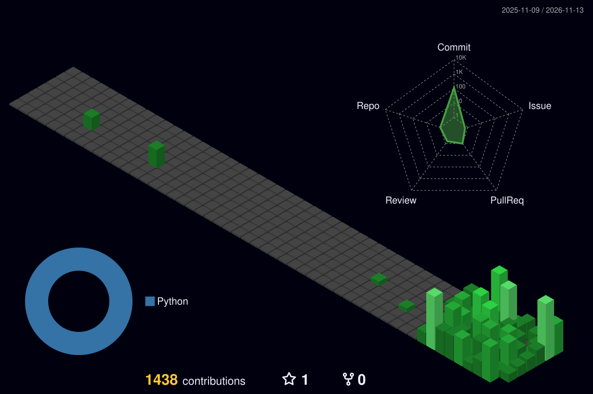

<b>▸ Contribution Snake Animation</b>

---

<table><tr><td width="100%" bgcolor="#07120B"><h2>06 / Public repositories — automatically updated</h2>
SYEDSTECH / REPOSITORIES
</td></tr></table>

| PUBLIC WORK | PRIVATE WORK |
|:---:|:---:|
| Auto-updated metadata | Curated project showcases |

<b>▸ Explore Public Repositories</b>

<!-- AUTO-PUBLIC-PROJECTS:START -->
**0 public project repositories** are currently discoverable. This list is automatically refreshed from GitHub repository metadata. Private project showcases above are curated separately and remain source-code protected.

No public project repositories are currently available.

**Need a similar project?** [WhatsApp Pakistan](https://wa.me/923065967478) · [WhatsApp UAE](https://wa.me/971552615993) · [Email](mailto:razahasnain0300@gmail.com)
<!-- AUTO-PUBLIC-PROJECTS:END -->

---

<table><tr><td width="100%" bgcolor="#07120B"><h2>07 / Work together</h2>
SYEDSTECH / CONTACT
</td></tr></table>

| CUSTOM WEB APPS | BUSINESS SOFTWARE | AI WORKFLOWS |
|:---:|:---:|:---:|
| Discuss scope | Plan delivery | Explore integrations |

<b>▸ Start a Software Project</b>

**Custom software · SaaS · Web applications · Business systems · AI-enabled workflows**

Tell me about your business challenge, users, required features and timeline.

SyedsTech · Lahore, Pakistan · Remote collaboration worldwide

