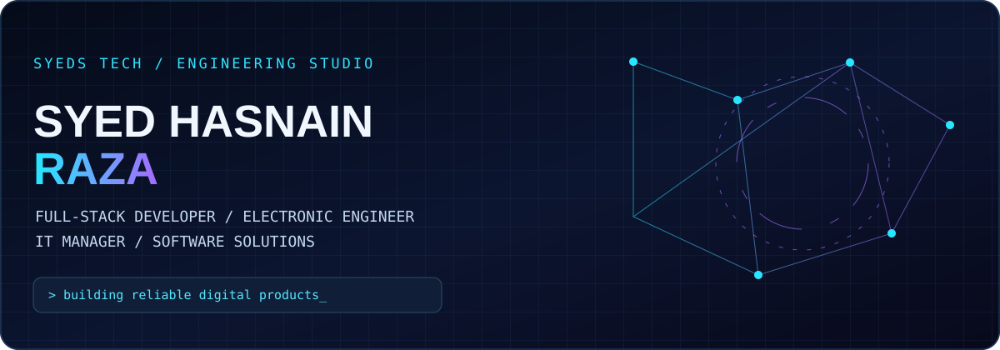
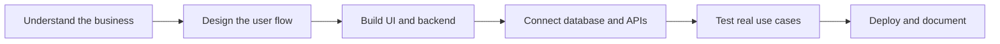

<div align="center">



### SYEDS TECH | Premium Software Engineering Studio

**Syed Hasnain Raza — Full-Stack Developer · Electronic Engineer · IT Manager**

**Custom Websites · React & Node.js Web Apps · PHP & MySQL · E-commerce · SaaS · ERP/CRM/POS · Android & iOS · Desktop Apps · AI Automation**


<br />

<a href="https://wa.me/923065967478?text=Hello%20Syeds%20Tech%2C%20I%20would%20like%20to%20discuss%20a%20software%20development%20project."></a>
<a href="mailto:razahasnain0300@gmail.com"></a>
<a href="https://wa.me/971552615993?text=Hello%20Syeds%20Tech%2C%20I%20would%20like%20to%20discuss%20a%20software%20development%20project."></a>

<br />


<sub>One animated portrait, a clean layout, and a focus on real-world solutions.</sub>

**[Visitors](#-profile-views--client-discovery)** · **[Team](#-our-development-team)** · **[Languages](#-programming-languages)** · **[About](#-about-me)** · **[Solutions](#-what-i-build)** · **[Projects](#-private-project-portfolio--21-projects)** · **[Tech](#-frameworks-tools--technology-stack)** · **[Workflow](#-how-i-deliver)** · **[Activity](#-github-activity)** · **[Contact](#-work-with-me)**

</div>

---

##  Profile views & client discovery

<div align="center">


**21 private-code project showcases** · **6 featured projects** · **15 more via Load More**

[**GitHub profile**](https://github.com/razahasnain0300-max) · [**Syeds Tech organization**](https://github.com/Syeds-Tech00) · [**WhatsApp UAE**](https://wa.me/971552615993) · [**WhatsApp Pakistan**](https://wa.me/923065967478)

</div>

<sub>The profile-view badge is supplied by an external service and may count repeat visits or image requests. It is not a unique-visitor or referral-source analytics report. GitHub README Markdown cannot accurately show where each visitor came from without a separate analytics-enabled website or service.</sub>

## Professional engineering services

| Custom development | Enterprise systems | Connected platforms |
|:---|:---|:---|
| **Full-stack websites & web apps** — responsive experiences, React, JavaScript, PHP and Node.js | **ERP, CRM, CMS & POS** — inventory, ledger, orders, admin portals and reporting | **REST APIs & integrations** — authentication, service connectivity and data flows |
| **E-commerce & marketplaces** — catalogs, variants, checkout, returns and vendor workflows | **Dashboards & automation** — management reporting, workflows and AI-assisted features | **Mobile & desktop project scope** — Android, iOS, Electron and cross-platform applications |

**Core tools:** HTML5 · CSS3 · JavaScript · Bootstrap · jQuery · React · PHP · Node.js · Express · Laravel · Python · Django · MySQL · PostgreSQL · MongoDB · Git · GitHub · REST APIs · MVC · WordPress · XAMPP · VS Code.

**Portfolio policy:** Featured project summaries are based on documented work. Technologies listed here are a broad project ecosystem, not a claim of equal hands-on proficiency in every technology.

##  Our development team

**Syeds Tech** presents a collaborative, multidisciplinary approach to delivering complete digital products. The roles below describe the disciplines involved in a full project delivery—not a verified public employee roster.

| Team / discipline | Focus |
|:---|:---|
|  **UI/UX & Product Design** | Research, wireframes, visual design, responsive experiences |
|  **Frontend Development** | Websites, web apps, interactive interfaces |
| **[ BACKEND / API ] Backend & API Development** | Business logic, integrations, authentication, services |
|  **Android & iOS Development** | Native and cross-platform mobile solutions |
|  **Desktop & Business Software** | POS, ERP, CRM, inventory, custom desktop workflows |
|  **Database & Architecture** | Relational design, data modeling, performance |
|  **AI & Automation** | AI-enabled features, integrations, workflow automation |
|  **QA, DevOps & Delivery** | Testing, deployment, monitoring and maintenance |

<div align="center">

[**Syeds Tech GitHub Organization**](https://github.com/Syeds-Tech00)

</div>

##  Programming languages

A wide language ecosystem for different project types. **Listed languages represent our service and technology scope, not verified equal proficiency or a claim that every language is used on every project.**

**Web & scripting:** JavaScript · TypeScript · PHP · Python · Ruby · Perl · Lua · Bash · PowerShell

**Application & systems:** Java · C# · C · C++ · Go · Rust · Kotlin · Swift · Dart · Objective-C · Visual Basic .NET

**Data & analytics:** SQL · R · MATLAB · Julia

**Web markup & styling:** HTML5 · CSS3 · Sass · Less · XML · JSON

<div align="center">


</div>

## About Syed Hasnain Raza — full-stack developer

I'm **Syed Hasnain Raza**, with **4+ years of web development experience**. I represent the Syeds Tech software development offering, bringing together the disciplines needed for end-to-end digital projects. I work on responsive interfaces, backend business rules, APIs, and relational databases.

My core hands-on technologies are **PHP, MySQL/MariaDB, JavaScript, HTML, CSS, and Bootstrap**. I enjoy connecting the full experience—from a customer's first click to an administrator's daily operations.

Our project approach is to turn workflows into maintainable software, with particular interest in **e-commerce, booking portals, inventory, reporting, customer management, and custom dashboards**.

```text
$ whoami
  Syed Hasnain Raza | Full-stack web developer

$ focus
  Useful products > unnecessary complexity
  Clear user journeys > disconnected screens
  Reliable data flows > impressive-looking demos
```

##  What I build

| Solution | Examples of work |
| --- | --- |
|  **Business websites** | Company websites, landing pages, portfolios, real-estate experiences |
|  **Web applications** | Admin dashboards, CRM tools, customer portals, SaaS-style systems |
|  **E-commerce & marketplaces** | Catalogs, carts, checkout journeys, vendor portals, stock management |
|  **Booking & service platforms** | Reservations, order tracking, schedules, messaging, payments |
|  **Inventory & operations** | Purchases, sales, ledger flows, stock visibility, reporting |
|  **Backends & integrations** | REST APIs, authentication, relational data, service integration |
|  **Desktop solutions** | Business tooling and POS-style application projects |
|  **Mobile solutions** | Android, iOS, cross-platform and progressive web app project scope |

> **Private-code policy:** Project source code and downloadable packages are not offered through this portfolio. For a similar feature or custom build, contact us via WhatsApp.

##  Private project portfolio — 21 projects

**Our source repositories are private.** These project summaries share high-level purposes, technology stacks and documented functionality—not code, downloadable packages or private credentials. Feature descriptions are based on project documentation; they are not a guarantee that every feature is live in production.

**21 project repositories showcased · 6 featured projects shown initially · 15 more on demand.**

Interested in a similar website, web app, Android/iOS app or custom software? Use the project-specific **Request on WhatsApp** link below. It opens a prefilled enquiry for **+971 55 261 5993**.

### 01 · GOEV Pakistan

**Purpose:** Electric-vehicle marketplace and ecosystem platform.

**Technologies:** TypeScript · React · TanStack Start · Tailwind CSS · Node.js · Express · PostgreSQL/Supabase.

**Documented features / scope:** Public browsing, customer and seller portals, admin operations, charging and services architecture.

**Key features:** Separate public, customer, seller and administrator experiences; electric-vehicle discovery and model information; seller operations; variant-specific colors and galleries; specification and feature groupings; pricing calculator deep links; review dimensions; API-backed management. Some features are under ongoing integration/testing.

[** Request a similar GOEV Pakistan project on WhatsApp**](https://wa.me/971552615993?text=Hello%20Syeds%20Tech%2C%20I%20am%20interested%20in%20a%20similar%20project%20to%20GOEV%20Pakistan.%20Please%20share%20features%2C%20pricing%20and%20development%20details.)

---

### 02 · MedBoostPro

**Purpose:** Education platform with separated public, student and admin experiences.

**Technologies:** React · TanStack Start · Vite · Node.js · Express.

**Documented features / scope:** Student-facing application, admin management, shared API, independently built application surfaces.

**Key features:** Independently built public, student and admin applications; shared backend API; student access workflows; administration architecture; database migrations; visitor analytics integration scope; deployment configuration and health endpoints. Deployment/runtime readiness must be verified separately.

[** Request a similar MedBoostPro project on WhatsApp**](https://wa.me/971552615993?text=Hello%20Syeds%20Tech%2C%20I%20am%20interested%20in%20a%20similar%20project%20to%20MedBoostPro.%20Please%20share%20features%2C%20pricing%20and%20development%20details.)

---

### 03 · Kanz Store

**Purpose:** Multi-category online store and retail operations platform.

**Technologies:** Node.js · Express · MySQL · Socket.IO · JavaScript.

**Documented features / scope:** Product variants, cart and checkout, inventory, order tracking, returns/refunds, customer accounts, real-time admin notifications.

**Key features:** Multi-category catalog; product colors and sizes; customer registration and email OTP; cart and server-validated checkout; order history and status tracking; real-time order notifications; inventory and stock restoration; cancellations, returns and refunds; admin messaging and customer contact management.

[** Request a similar Kanz Store project on WhatsApp**](https://wa.me/971552615993?text=Hello%20Syeds%20Tech%2C%20I%20am%20interested%20in%20a%20similar%20project%20to%20Kanz%20Store.%20Please%20share%20features%2C%20pricing%20and%20development%20details.)

---

### 04 · Dr. Shoaib Zafar

**Purpose:** Specialist website and clinic management ecosystem.

**Technologies:** React · Node.js · Express · MySQL.

**Documented features / scope:** Public professional website, administrative workspace, doctor portal, clinic inventory module; some content/release items pending review.

**Key features:** Specialist public website; clinic and doctor administration; research and educational content structure; doctor portal; MediStock inventory module; backend/database integration. Clinical content and production-release items require review.

[** Request a similar Dr. Shoaib Zafar project on WhatsApp**](https://wa.me/971552615993?text=Hello%20Syeds%20Tech%2C%20I%20am%20interested%20in%20a%20similar%20project%20to%20Dr.%20Shoaib%20Zafar.%20Please%20share%20features%2C%20pricing%20and%20development%20details.)

---

### 05 · Meem Connects

**Purpose:** Multi-vendor commerce project.

**Technologies:** TypeScript · React · TanStack Start · Tailwind CSS.

**Documented features / scope:** Marketplace-oriented interface foundation; detailed commerce workflows not independently verified.

**Project scope:** Multi-vendor marketplace concept, responsive storefront foundation and commerce interface. Vendor payments, order fulfillment and other advanced workflows are not confirmed as implemented.

[** Request a similar Meem Connects project on WhatsApp**](https://wa.me/971552615993?text=Hello%20Syeds%20Tech%2C%20I%20am%20interested%20in%20a%20similar%20project%20to%20Meem%20Connects.%20Please%20share%20features%2C%20pricing%20and%20development%20details.)

---

### 06 · Amaken Real Estate

**Purpose:** Property and real-estate website.

**Technologies:** PHP · MySQL · PDO · Bootstrap.

**Documented features / scope:** Property-focused web experience, server-side database integration and contact configuration.

**Key features / documented scope:** Property-focused website; PHP/PDO data access; Bootstrap responsive presentation; database configuration; contact/email integration configuration. Specific listing and CRM functions are not independently verified.

[** Request a similar Amaken Real Estate project on WhatsApp**](https://wa.me/971552615993?text=Hello%20Syeds%20Tech%2C%20I%20am%20interested%20in%20a%20similar%20project%20to%20Amaken%20Real%20Estate.%20Please%20share%20features%2C%20pricing%20and%20development%20details.)

---

<details>
<summary><b> Load More Projects — View 15 More (7–21 of 21)</b></summary>

### 07 · rTMS Machine

**Purpose:** Neuromodulation-focused web project.

**Technologies:** TypeScript · React · TanStack Start · Tailwind CSS.

**Documented features / scope:** Web application foundation; specialized workflow implementation not independently verified.

[** Request a similar rTMS Machine project on WhatsApp**](https://wa.me/971552615993?text=Hello%20Syeds%20Tech%2C%20I%20am%20interested%20in%20a%20similar%20project%20to%20rTMS%20Machine.%20Please%20share%20features%2C%20pricing%20and%20development%20details.)

---

### 08 · Syeds Tech Company Website

**Purpose:** IT services and digital agency website.

**Technologies:** TypeScript · React · TanStack Start · Tailwind CSS.

**Documented features / scope:** Business website foundation and service presentation; detailed features not independently verified.

[** Request a similar Syeds Tech Company Website project on WhatsApp**](https://wa.me/971552615993?text=Hello%20Syeds%20Tech%2C%20I%20am%20interested%20in%20a%20similar%20project%20to%20Syeds%20Tech%20Company%20Website.%20Please%20share%20features%2C%20pricing%20and%20development%20details.)

---

### 09 · 5D Interactive ARE Business Card

**Purpose:** Interactive digital business card.

**Technologies:** HTML · CSS · JavaScript · Bootstrap · React (documented technology ecosystem).

**Documented features / scope:** Responsive digital identity and interactive web presentation.

[** Request a similar project on WhatsApp**](https://wa.me/971552615993?text=Hello%20Syeds%20Tech%2C%20I%20am%20interested%20in%20a%20project%20similar%20to%205D%20Interactive%20ARE%20Business%20Card.%20Please%20share%20details%20and%20pricing.)

---

### 10 · 3D/5D ARE Business Card

**Purpose:** Immersive digital business card.

**Technologies:** 3D interface · Web animations (specific stack not verified).

**Documented features / scope:** Floating information cubes, animated presentation, profile details and vCard export.

[** Request a similar project on WhatsApp**](https://wa.me/971552615993?text=Hello%20Syeds%20Tech%2C%20I%20am%20interested%20in%20a%20project%20similar%20to%203D%2F5D%20ARE%20Business%20Card.%20Please%20share%20details%20and%20pricing.)

---

### 11 · Amaken CEO Dashboard

**Purpose:** Executive real-estate dashboard.

**Technologies:** Technology stack not independently verified.

**Documented features / scope:** Property, sales, leads and performance analytics dashboard scope.

[** Request a similar project on WhatsApp**](https://wa.me/971552615993?text=Hello%20Syeds%20Tech%2C%20I%20am%20interested%20in%20a%20project%20similar%20to%20Amaken%20CEO%20Dashboard.%20Please%20share%20details%20and%20pricing.)

---

### 12 · Amaken Executive Management

**Purpose:** Leadership reporting and property management.

**Technologies:** Technology stack not independently verified.

**Documented features / scope:** Executive oversight, property management and analytics scope.

[** Request a similar project on WhatsApp**](https://wa.me/971552615993?text=Hello%20Syeds%20Tech%2C%20I%20am%20interested%20in%20a%20project%20similar%20to%20Amaken%20Executive%20Management.%20Please%20share%20details%20and%20pricing.)

---

### 13 · Fatima Boutique

**Purpose:** Boutique storefront project.

**Technologies:** TypeScript · React · TanStack Start · Tailwind CSS.

**Documented features / scope:** Storefront application foundation; checkout and inventory workflows not verified.

[** Request a similar project on WhatsApp**](https://wa.me/971552615993?text=Hello%20Syeds%20Tech%2C%20I%20am%20interested%20in%20a%20project%20similar%20to%20Fatima%20Boutique.%20Please%20share%20details%20and%20pricing.)

---

### 14 · Hadia Collection

**Purpose:** Fashion e-commerce and store operations.

**Technologies:** Node.js · Express · MySQL · Socket.IO.

**Documented features / scope:** Customer accounts, cart/COD checkout, inventory, returns/refunds, admin portal and real-time order updates.

[** Request a similar project on WhatsApp**](https://wa.me/971552615993?text=Hello%20Syeds%20Tech%2C%20I%20am%20interested%20in%20a%20project%20similar%20to%20Hadia%20Collection.%20Please%20share%20details%20and%20pricing.)

---

### 15 · Rehab Connects

**Purpose:** Rehabilitation-related digital project.

**Technologies:** Technology stack not independently verified.

**Documented features / scope:** Project-specific features not independently documented.

[** Request a similar project on WhatsApp**](https://wa.me/971552615993?text=Hello%20Syeds%20Tech%2C%20I%20am%20interested%20in%20a%20project%20similar%20to%20Rehab%20Connects.%20Please%20share%20details%20and%20pricing.)

---

### 16 · SYDEX AI Command Center

**Purpose:** Windows-first AI desktop assistant.

**Technologies:** React · Electron · Three.js · Gemini · Ollama.

**Documented features / scope:** Holographic interface, multilingual voice/chat, permission-controlled local agents and audit logs; local inference requires setup.

**Key features:** Electron desktop shell; responsive React interface; Three.js holographic avatar; Gemini integration; local Ollama integration prerequisites; multilingual chat/voice interface; tool permission gateway, approvals, audit logging and task telemetry.

[** Request a similar project on WhatsApp**](https://wa.me/971552615993?text=Hello%20Syeds%20Tech%2C%20I%20am%20interested%20in%20a%20project%20similar%20to%20SYDEX%20AI%20Command%20Center.%20Please%20share%20details%20and%20pricing.)

---

### 17 · Over The Top

**Purpose:** Custom digital project.

**Technologies:** Technology stack not independently verified.

**Documented features / scope:** Project purpose and feature implementation pending documentation.

[** Request a similar project on WhatsApp**](https://wa.me/971552615993?text=Hello%20Syeds%20Tech%2C%20I%20am%20interested%20in%20a%20project%20similar%20to%20Over%20The%20Top.%20Please%20share%20details%20and%20pricing.)

---

### 18 · Syeds Collection

**Purpose:** Retail storefront project.

**Technologies:** TypeScript · React · TanStack Start · Tailwind CSS.

**Documented features / scope:** Commerce-oriented application foundation; detailed store workflows not verified.

[** Request a similar project on WhatsApp**](https://wa.me/971552615993?text=Hello%20Syeds%20Tech%2C%20I%20am%20interested%20in%20a%20project%20similar%20to%20Syeds%20Collection.%20Please%20share%20details%20and%20pricing.)

---

### 19 · Gani Designer

**Purpose:** Creative/design website project.

**Technologies:** TypeScript · React · TanStack Start · Tailwind CSS.

**Documented features / scope:** Web application foundation; specific designer features not verified.

[** Request a similar project on WhatsApp**](https://wa.me/971552615993?text=Hello%20Syeds%20Tech%2C%20I%20am%20interested%20in%20a%20project%20similar%20to%20Gani%20Designer.%20Please%20share%20details%20and%20pricing.)

---

### 20 · Telal Al Qema Contracting

**Purpose:** Contracting company website.

**Technologies:** PHP · Bootstrap · HTML · CSS.

**Documented features / scope:** Homepage, services pages, shared navigation and contact form.

[** Request a similar project on WhatsApp**](https://wa.me/971552615993?text=Hello%20Syeds%20Tech%2C%20I%20am%20interested%20in%20a%20project%20similar%20to%20Telal%20Al%20Qema%20Contracting.%20Please%20share%20details%20and%20pricing.)

---

### 21 · Syed Imran Law Associates

**Purpose:** Law firm website and management project.

**Technologies:** TypeScript · React · TanStack Start · Tailwind CSS · MySQL · Drizzle ORM.

**Documented features / scope:** Database-backed application foundation; specific law-office workflows not verified.

[** Request a similar project on WhatsApp**](https://wa.me/971552615993?text=Hello%20Syeds%20Tech%2C%20I%20am%20interested%20in%20a%20project%20similar%20to%20Syed%20Imran%20Law%20Associates.%20Please%20share%20details%20and%20pricing.)

---

</details>

<div align="center">

### Have a different project in mind?

**Websites · Web Apps · SaaS · E-commerce · ERP · CRM · POS · Android · iOS · Desktop · AI Integrations**

**WhatsApp UAE:** [+971 55 261 5993](https://wa.me/971552615993) · **WhatsApp Pakistan:** [+92 306 596 7478](https://wa.me/923065967478) · **Email:** [razahasnain0300@gmail.com](mailto:razahasnain0300@gmail.com)

[** Discuss your custom project on WhatsApp**](https://wa.me/971552615993?text=Hello%20Syeds%20Tech%2C%20I%20would%20like%20to%20discuss%20a%20custom%20software%20development%20project.%20Please%20contact%20me.)

</div>

## Automatically updated public projects

The catalog below refreshes **every 6 hours** and can also be updated manually from GitHub Actions. Newly created **public** repositories and changes to their descriptions, main language or latest push date appear here automatically. Existing **private** project showcases remain curated above: private code, files and repository links are never automatically published.

<!-- AUTO-PUBLIC-PROJECTS:START -->
**0 public project repositories** are currently discoverable. This list is automatically refreshed from GitHub repository metadata. Private project showcases above are curated separately and remain source-code protected.

No public project repositories are currently available.

**Need a similar project?** [WhatsApp Pakistan](https://wa.me/923065967478) · [WhatsApp UAE](https://wa.me/971552615993) · [Email](mailto:razahasnain0300@gmail.com)
<!-- AUTO-PUBLIC-PROJECTS:END -->

##  Frameworks, tools & technology stack

**Daily development stack**

<p>

</p>

**Additional platform and framework ecosystem**

I explore or work with technologies appropriate to project requirements; this is a technology overview, **not a claim of equal expertise across every language or platform**.

| Platform | Technologies to evaluate or use as suitable |
| --- | --- |
| Frontend | TypeScript, React, Next.js, Vue, Angular, Tailwind CSS |
| Backend | Node.js, Express, Laravel, Python, Django, FastAPI, ASP.NET |
| Mobile | Kotlin, Swift, Flutter, React Native, Dart |
| Desktop | .NET, Electron, Tauri, Qt |
| Data & delivery | PostgreSQL, SQLite, Docker, GitHub Actions, Linux, cloud hosting |
| Other languages | Java, C#, C/C++, Go, Rust, Ruby |

<details>
<summary><b>Explore the wider development ecosystem</b></summary>

<br />


</details>

##  How I deliver



I favor usable interfaces, secure data handling, clear validation, role-based access where needed, and reproducible setups. Each project deserves attention to loading states, error handling, mobile responsiveness, and complete UI-to-database integration.

##  GitHub activity

<div align="center">


<sub>Contribution visualization is generated by an existing GitHub Actions workflow.</sub>

<br /><br />


</div>

<details>
<summary><b>View contribution snake animation</b></summary>

<br />


</details>

##  Work with me

Need a **website, web app, admin system, API, e-commerce platform, or custom business solution**?

Tell us the problem, key features, expected users, platform, and timeline. We can discuss a suitable development plan. **Project enquiries:** WhatsApp UAE **+971 55 261 5993** · WhatsApp Pakistan **+92 306 596 7478** · Email **razahasnain0300@gmail.com**.

<div align="center">

<a href="mailto:razahasnain0300@gmail.com"></a>

<br /><br />

[** Contact Syeds Tech on WhatsApp (UAE)**](https://wa.me/971552615993?text=Hello%20Syeds%20Tech%2C%20I%20would%20like%20to%20discuss%20a%20project.)

[** WhatsApp Pakistan: +92 306 596 7478**](https://wa.me/923065967478?text=Hello%20Syeds%20Tech%2C%20I%20would%20like%20to%20discuss%20a%20software%20development%20project.) · [** Email: razahasnain0300@gmail.com**](mailto:razahasnain0300@gmail.com)

<sub>© Syed Hasnain Raza · Websites · Web applications · Mobile apps · Desktop software · Business systems</sub>

</div>
