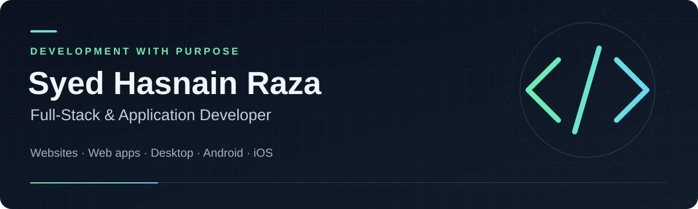
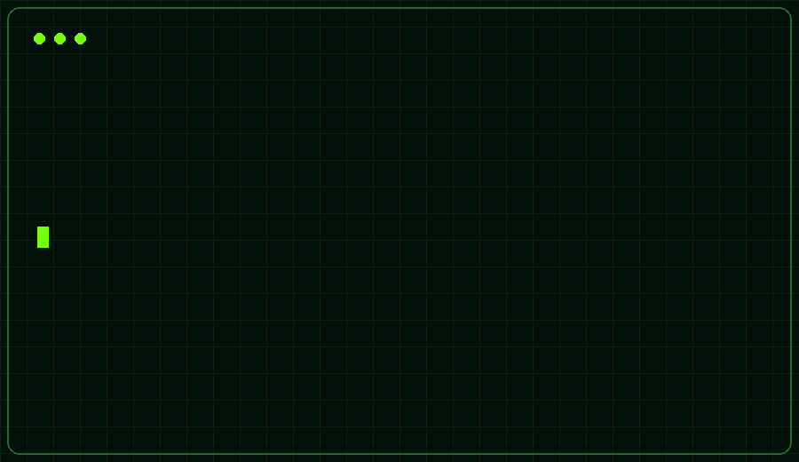

# Turning business ideas into useful software.

I build responsive websites, e-commerce experiences, and custom web applications, 
connecting thoughtful interfaces with the backend systems that power them.

**PHP · MySQL · JavaScript · Bootstrap · REST APIs**

[Explore my expertise](#what-i-build) · [How I work](#how-i-work) · [Let's connect](#lets-build-something-useful)

---

## About me

I'm **Syed Hasnain Raza**, a web developer with **4+ years of experience** working across frontend interfaces, backend logic, and relational databases.

My focus is practical business software: online stores, booking flows, customer portals, inventory tools, and admin dashboards. I care about making everyday tasks easier for both customers and the people managing the system.

## What I build

| Focus | What I can help you create |
| :--- | :--- |
| **Websites & storefronts** | Responsive business websites, product catalogs, shopping carts, and e-commerce experiences. |
| **Business applications** | Admin dashboards, inventory and ledger tools, customer portals, and reporting workflows. |
| **Booking & service platforms** | Booking flows, order tracking, vendor dashboards, and customer communication features. |
| **Backend & integrations** | PHP and JavaScript application logic, REST APIs, authentication, and MySQL data models. |

## My development toolkit

| Layer | Technologies & practices |
| :--- | :--- |
| **Frontend** | HTML5, CSS3, JavaScript, Bootstrap, responsive layouts, AJAX |
| **Backend** | PHP, Node.js, Express, REST APIs |
| **Database** | MySQL, MariaDB, PDO, relational data modeling |
| **Workflow** | Git, GitHub, XAMPP, debugging, integration testing |

I choose technologies around the project's needs, with an emphasis on maintainability and a straightforward handover.

## How I work

1. **Understand the workflow** — clarify the users, business rules, and what a successful result looks like.
2. **Build the full experience** — connect the interface, application logic, and database.
3. **Check real scenarios** — test forms, permissions, calculations, and the main user journeys.
4. **Prepare for handover** — organize the code and explain setup and configuration.

<strong>Behind the code — my animated workspace</strong>

 

---

## Let's build something useful

Have a website or web application in mind? Share the problem you want to solve, the features you need, and your target timeline.

**[Email me about your project](mailto:razahasnain0300@gmail.com)** · [GitHub repositories](https://github.com/razahasnain0300-max?tab=repositories)

Syed Hasnain Raza · Websites · E-commerce · Custom web applications
