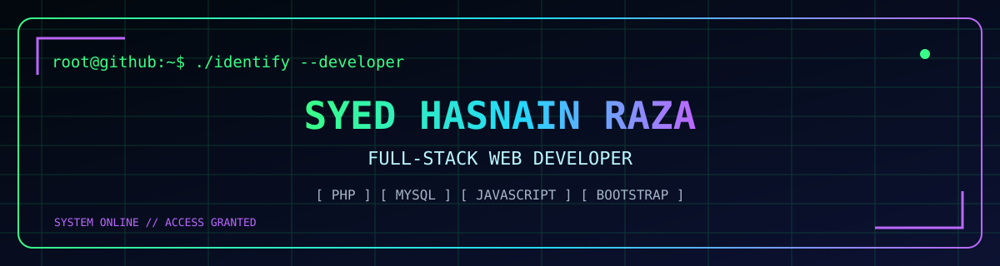
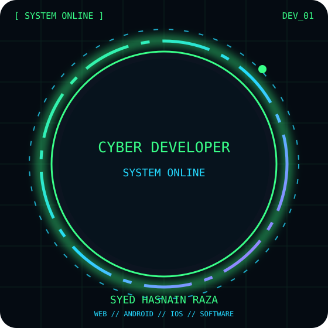

<div align="center">






<br />


</div>

### `> whoami`

```bash
$ developer --profile
NAME       : Syed Hasnain Raza
ROLE       : Full-Stack & Cross-Platform Application Developer
SERVICES   : Websites • Web Apps • Android Apps • iOS Apps
SOLUTIONS  : E-commerce • Marketplaces • SaaS • Dashboards • APIs
TECH       : Multi-language • Multi-framework • Multi-platform
STATUS     : Building useful things on the web
```

### `> services --all-platforms`

🌐 **Websites:** Business, corporate, portfolio, blogs, e-commerce, marketplaces, CMS, and landing pages.

💻 **Web applications:** SaaS, dashboards, admin panels, CRM, ERP, booking systems, portals, and custom business software.

📱 **Mobile applications:** Android and iOS apps, cross-platform apps, PWAs, and mobile-first experiences.

⚙️ **Backend & cloud:** REST/GraphQL APIs, databases, authentication, payments, integrations, deployment, and automation.

### `> languages --ecosystem`

**Programming & scripting:** JavaScript · TypeScript · PHP · Python · Java · Kotlin · Swift · Dart · C · C++ · C# · Go · Rust · Ruby · SQL · Bash

**Web & UI:** HTML5 · CSS3 · React · Next.js · Vue · Angular · Node.js · Express · Laravel · Django · Flask · FastAPI · ASP.NET · Bootstrap · Tailwind CSS · jQuery

**Mobile:** Flutter · React Native · Android (Kotlin/Java) · iOS (Swift) · Progressive Web Apps

**Data & infrastructure:** MySQL · PostgreSQL · MongoDB · SQLite · Firebase · Redis · Docker · Git · GitHub Actions · Linux · AWS · Azure · Google Cloud

*Technologies listed represent the development ecosystem and solution coverage, not a claim of equal proficiency in every language or framework.*

### `> tech --stack`

<div align="center">


</div>

### `> github --telemetry`

<div align="center">


</div>

### `> contribution --snake`

<div align="center">


</div>

### `> contribution --3d`

<div align="center">


</div>

### `> connect --developer`

<div align="center">

[](https://github.com/razahasnain0300-max)

**`[ ACCESS GRANTED ]`** · *Thanks for visiting my digital workspace.*

</div>
