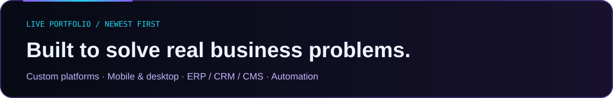
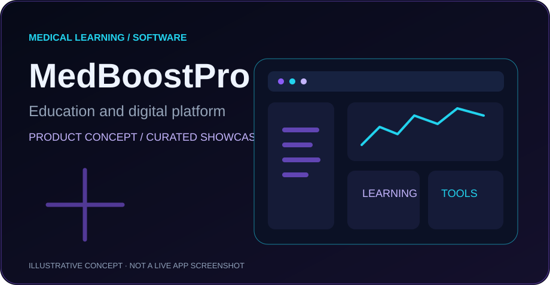
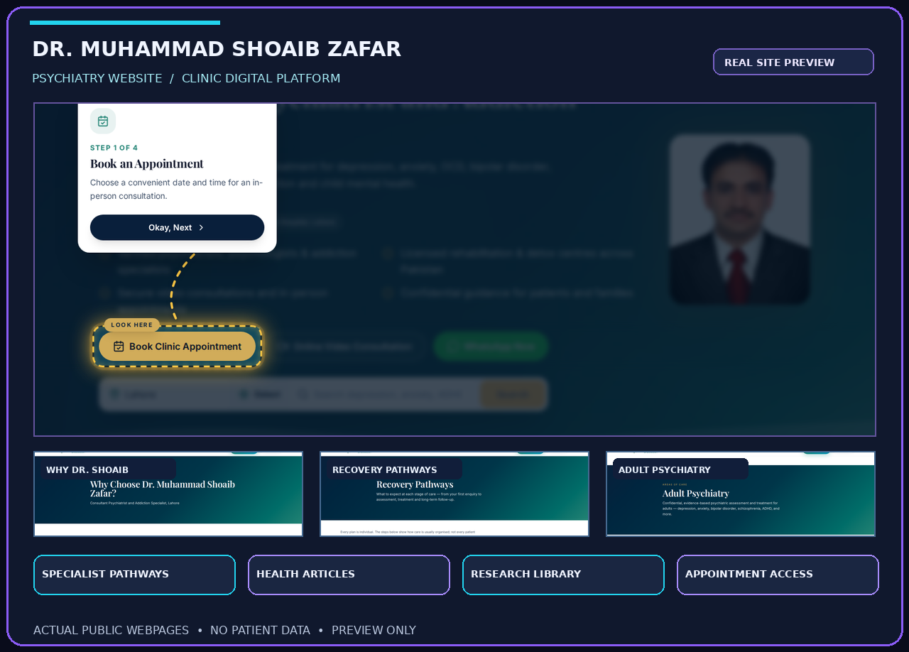
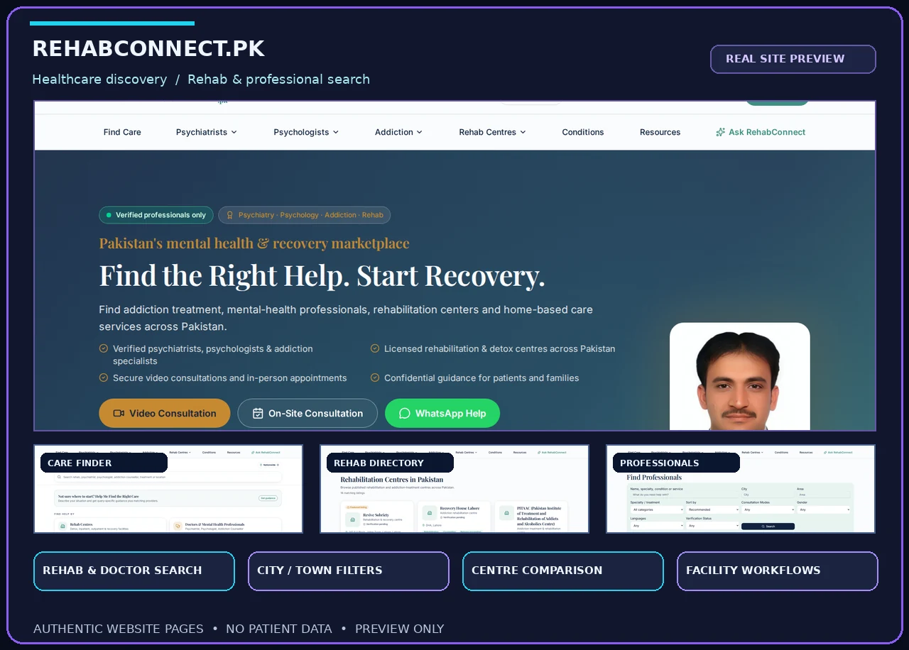
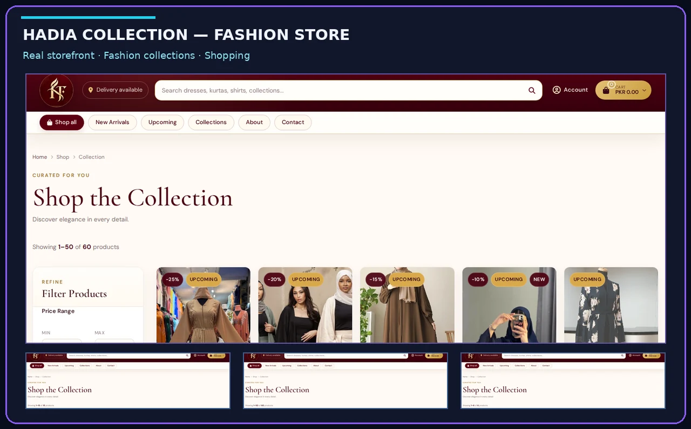

<!-- Syed Hasnain Raza — GitHub-safe client portfolio. Personalized editorial layout inspired by a visual reference. No private application source. -->

<table width="100%">
  <tr>
    <td align="center"><a href="#about"><strong>ABOUT</strong></a></td>
    <td align="center"><a href="#services"><strong>SERVICES</strong></a></td>
    <td align="center"><a href="#projects"><strong>PROJECTS</strong></a></td>
    <td align="center"><a href="#technology"><strong>TECHNOLOGIES</strong></a></td>
    <td align="center"><a href="#activity"><strong>ACTIVITY</strong></a></td>
    <td align="center"><a href="#contact"><strong>CONTACT</strong></a></td>
  </tr>
</table>

**Websites &amp; Web Applications · Desktop Software · Android &amp; iOS · Enterprise Systems · AI &amp; Automation**

Lahore, Pakistan &nbsp; / &nbsp; Dubai, UAE &nbsp; / &nbsp; Worldwide Clients

**From first idea to production-ready software — we design, develop, integrate and support tailored digital products.**

[**Request a Project Proposal**](mailto:razahasnain0300@gmail.com?subject=Custom%20Software%20Project%20Inquiry) &nbsp; · &nbsp; [**Browse Our Work**](./PORTFOLIO.md) &nbsp; · &nbsp; [**Explore Services**](./SERVICES.md)

## About

**Syed's IT Solution & Digital Marketing Services** is a **multidisciplinary organization/team** delivering digital products and software solutions through collaboration across technical and creative disciplines.

**Technical Lead:** **Syed Hasnain Raza** — Software Developer, IT Manager, Full-Stack Engineer and Electronic Engineer. **Lahore, Pakistan · Dubai, UAE · Remote collaboration worldwide.**

**Our team approach:** We combine project planning, UI/UX, frontend and backend engineering, database systems, mobile and desktop solutions, quality assurance, release engineering and ongoing support. Individual assignments and availability are agreed for each project.

**What we design and deliver:** Any scale of website or landing page; tailor-made **web apps, Android applications, iOS apps, Windows/macOS/Linux desktop software**; **ERP, CRM, CMS, HRMS, POS, LMS, SaaS**; multi-vendor marketplaces, e-commerce stores, admin and customer portals, cloud software, database-backed systems, device/IoT integrations, AI tools and automation. We select the language and stack around the actual project, not the other way around. Team expertise and delivery feasibility are confirmed per engagement.

[**Request a proposal from our team →**](mailto:razahasnain0300@gmail.com?subject=Enterprise%20Software%20Development%20Inquiry)

## Services

Design, engineering, integration and ongoing improvements for organizations that need **web, desktop and mobile software**. We are not restricted to a single programming language or framework.

[**Full service directory**](./SERVICES.md) &nbsp; · &nbsp; [**Technology options**](./TECHNOLOGY_STACK.md)

### Full-service software engineering

| Digital experiences | Business systems | Applications and integrations |
|:--|:--|:--|
| Corporate, personal, nonprofit and industry websites | **ERP**, accounting workflows, procurement and inventory | Custom web apps, SaaS, PWA and customer portals |
| Landing pages: PPC, lead generation, apps, products, events and sales funnels | **CRM**, lead pipelines, support, HRMS and project management | **Android & iOS**, desktop software, device integrations |
| Content portals, blogs, news, editorial platforms, multilingual sites | **CMS**, LMS, POS, bookings and reporting dashboards | E-commerce, marketplaces, APIs, automation and AI assistants |

**[Explore the complete website, ERP, CRM, CMS, SaaS and app service catalog →](./SERVICES.md)**

### What type of project do you need?

| 🌐 Websites & online presence | 🧩 Web apps & business software | 📱 Mobile & 💻 desktop apps |
|:--|:--|:--|
| Corporate, company, startup and agency websites | Custom portals, dashboards and SaaS platforms | Android apps (native or cross-platform) |
| Portfolio, personal, real-estate and property websites | ERP, CRM, CMS, HRMS, POS, LMS and inventory | iPhone/iPad apps and cross-platform mobile apps |
| Blogs, news, e-learning, healthcare and directories | Booking, billing, accounting and subscription systems | Windows desktop apps and Windows services |
| E-commerce, Shopify/WordPress and multi-vendor stores | Hospital, school, gym, hotel, restaurant and construction systems | macOS/Linux software and offline-first tools |
| Responsive, multilingual and SEO-ready landing pages | Marketplace, logistics, analytics and membership apps | Device integrations, biometric tools and automation |
| Web design, redesign and website maintenance | Secure APIs, AI assistants, workflows and integrations | Custom utilities, sync engines and companion apps |

**Industries:** Retail & e-commerce · Health & medical · Education · Real estate · Construction · Logistics · Hospitality · Finance workflows · Sports & gyms · Agencies · Startups · Professional services.

**Whether you need a small business website or a large multi-panel system, share your requirements and we'll help scope a practical solution.**

[**See the full project and service catalog →**](./SERVICES.md) &nbsp;·&nbsp; [**Discuss your custom software →**](mailto:razahasnain0300@gmail.com?subject=My%20Website%20or%20Software%20Idea)

## Engineering workspace

A view into our software-delivery approach. These are **illustrative interface visualizations**, not operational dashboards or fabricated skill scores.

<strong>Explore our development interface and technical diagrams</strong>

### Additional visual panels

Built in the same purple/cyan brand identity, these panels combine an animated terminal introduction, technology toolbox and an illustrative category map. They represent the team and its service scope, not made-up technical ratings.

## Highlights

**Selected public-facing case studies:** Dr. Shoaib Zafar (healthcare and clinic content), RehabConnect (healthcare discovery) and Hadia Collection (e-commerce). Each showcase distinguishes actual public-page screenshots from illustrative concepts and private-system capabilities.

[**Read our project case studies**](./PORTFOLIO.md) &nbsp; · &nbsp; [**Request similar software**](mailto:razahasnain0300@gmail.com?subject=Custom%20Software%20Project%20Inquiry)

## Projects

Our approved project gallery and selected public repository previews update through GitHub Actions. Application source code and private repositories are not published by this README.

<!-- AUTO-PROJECT-GALLERY:START -->
## Our latest software projects

**14 showcased projects** · Latest additions first · Live public-repository discovery

<table>
<tr>
<td width="50%" align="center" valign="top"> <b>ILLUSTRATIVE PORTFOLIO CONCEPT</b> <strong>MedBoostPro</strong> <b>🏷️ Healthcare / Education</b> Medical education and software platform concept</td>
<td width="50%" align="center" valign="top"> <b>REAL PUBLIC WEBSITE PREVIEW</b> <strong>DR. SHOAIB ZAFAR</strong> <b>🏷️ Psychiatry Clinic Website · CMS · Patient Services</b> Professional psychiatry website with care pathways, appointment access, specialist information and educational resources. <b>✨ FEATURES</b> <kbd>👨‍⚕️ Doctor Profile</kbd> <kbd>🧠 Adult Psychiatry</kbd> <kbd>🧒 Child &amp; Adolescent Care</kbd> <kbd>🧭 Recovery Pathways</kbd> <kbd>🧩 Addiction Information</kbd> <kbd>💬 Psychotherapy Services</kbd> <kbd>💻 Telepsychiatry</kbd> <kbd>📰 Mental-Health Articles</kbd> <b>⚙️ BUILT WITH</b> <kbd>React</kbd> <kbd>TypeScript</kbd> <kbd>TanStack Start</kbd> <kbd>Node.js</kbd> <kbd>Express</kbd> <kbd>MySQL</kbd></td>
</tr>
<tr>
<td width="50%" align="center" valign="top"> <b>ILLUSTRATIVE PORTFOLIO CONCEPT</b> <strong>GANI DESIGNER</strong> <b>🏷️ E-commerce</b> Independent retail storefront</td>
<td width="50%" align="center" valign="top"> <b>ILLUSTRATIVE PORTFOLIO CONCEPT</b> <strong>SYED&#x27;S COLLECTION</strong> <b>🏷️ Retail</b> Retail storefront and order-management concept</td>
</tr>
<tr>
<td width="50%" align="center" valign="top"> <b>ILLUSTRATIVE PORTFOLIO CONCEPT</b> <strong>OVER THE TOP CRM</strong> <b>🏷️ CRM / Operations</b> Gym memberships and device-integrated management</td>
<td width="50%" align="center" valign="top"> <b>ILLUSTRATIVE PORTFOLIO CONCEPT</b> <strong>SYDEX / JAVIZ</strong> <b>🏷️ Desktop / AI</b> Desktop AI assistant and automation concept</td>
</tr>
<tr>
<td width="50%" align="center" valign="top"> <b>REAL PUBLIC WEBSITE PREVIEW</b> <strong>REHABCONNECT</strong> <b>🏷️ Healthcare Directory · Rehab Finder · Facility Operations</b> Find rehabilitation centres and mental-health professionals, compare services and access recovery resources. <b>✨ FEATURES</b> <kbd>🏥 Rehab Centre Directory</kbd> <kbd>🩺 Professional Profiles</kbd> <kbd>🔎 Smart Care Finder</kbd> <kbd>📍 City &amp; Town Filters</kbd> <kbd>⚖️ Centre Comparison</kbd> <kbd>🧭 Care Matcher</kbd> <kbd>📚 Recovery Resources</kbd> <kbd>🧪 Research &amp; Insights</kbd> <b>⚙️ BUILT WITH</b> <kbd>React</kbd> <kbd>TypeScript</kbd> <kbd>TanStack Start</kbd> <kbd>Node.js</kbd> <kbd>Express</kbd> <kbd>MySQL</kbd></td>
<td width="50%" align="center" valign="top"> <b>REAL PUBLIC WEBSITE PREVIEW</b> <strong>HADIA COLLECTION</strong> <b>🏷️ Fashion E-Commerce Website / Online Store</b> Hadia &amp; Taha fashion storefront — curated collections, new arrivals, product browsing and customer shopping. <b>✨ FEATURES</b> <kbd>🛍️ Fashion Collections</kbd> <kbd>✨ New Arrivals</kbd> <kbd>🔎 Product Search</kbd> <kbd>🎛️ Catalog Filters</kbd> <kbd>📦 Color &amp; Size Options</kbd> <kbd>🛒 Shopping Cart</kbd> <kbd>💵 Cash on Delivery</kbd> <kbd>🚚 Order Tracking</kbd> <b>⚙️ BUILT WITH</b> <kbd>Node.js</kbd> <kbd>Express</kbd> <kbd>EJS</kbd> <kbd>MySQL</kbd> <kbd>Socket.IO</kbd></td>
</tr>
</table>

**[Explore all 14 projects and case studies →](./PORTFOLIO.md)**

*Project count is generated from public repositories and approved showcases; it is not a claim about undisclosed private projects. Public repositories refresh hourly. Private sources are not linked.*
<!-- AUTO-PROJECT-GALLERY:END -->

## Activity

Authentic GitHub contributions and automatically generated activity artwork. The animation below is updated by the existing workflow; we do not simulate contributions, invent statistics or manufacture commits.

<!-- PURPLE-SNAKE:START -->
## Purple Contribution Snake — Live GitHub Activity

<picture>
  <source media="(prefers-color-scheme: dark)" srcset="https://raw.githubusercontent.com/razahasnain0300-max/razahasnain0300-max/output/snake-purple-dark.svg" />
  <source media="(prefers-color-scheme: light)" srcset="https://raw.githubusercontent.com/razahasnain0300-max/razahasnain0300-max/output/snake-purple-light.svg" />
  
</picture>

**Real contributions. Purple motion.** This animation follows your genuine GitHub contribution calendar and refreshes twice daily through GitHub Actions — without creating artificial commits or changing GitHub's official contribution count.

**Animated project activity preview.** The animation is for presentation; it does not open developer files.

[**✉️ Request a project proposal →**](mailto:razahasnain0300@gmail.com?subject=Software%20Development%20Project%20Inquiry)

<!-- PURPLE-SNAKE:END -->

<!-- PUBLIC-REPO-AUTO:START -->
## Latest public project previews · Automatically updated

There are no additional **public** repositories currently. New public repositories will appear automatically after the next sync.

Project cards above show previews only.

*Updated approximately hourly. Project cards do not link to source code. Private repositories remain protected.*
<!-- PUBLIC-REPO-AUTO:END -->

<!-- APPROVED-CASESTUDIES:START -->
<!-- APPROVED-CASESTUDIES:END -->

## Technology

**Technology-flexible engineering:** the team scopes and evaluates tools by product requirements, maintainability, integrations and available specialist expertise. Technologies shown are *project options*; they are not claims of mastery of every language.

<strong>Expand the full technical ecosystem diagram</strong>

### Programming languages, frameworks & platform capabilities

| Technology area | Languages, frameworks and project options |
|:--|:--|
| **Web & interactive UI** | HTML5, CSS3, JavaScript, TypeScript, React, **Next.js**, **Three.js**, Vue, Nuxt, Angular, Svelte, Tailwind |
| **Backend & APIs** | **Python**, Django, FastAPI, Flask, **Node.js**, Express, NestJS, PHP/Laravel, Ruby/Rails, Go, REST, GraphQL |
| **Enterprise & .NET** | **C#**, **.NET / ASP.NET Core**, Blazor, **Java**, Spring Boot, Kotlin, C/C++, Rust |
| **Android & iOS** | **Java**, **Kotlin**, **Swift**, Objective-C, **Flutter/Dart**, React Native, Ionic/Capacitor |
| **Desktop & systems** | Electron, Tauri, Python, **C#/.NET**, Java, C++, Qt, WPF, WinUI, .NET MAUI, Bash, PowerShell |
| **Databases & DevOps** | MySQL, PostgreSQL, MariaDB, SQL Server, SQLite, MongoDB, Redis, Firebase, Git, GitHub Actions, Linux, VPS, Docker, AWS, Azure, GCP |
| **CMS & e-commerce ecosystems** | WordPress, WooCommerce, Shopify, Drupal, headless CMS, Magento, custom CMS |

**More languages & technologies for project evaluation:** JavaScript, TypeScript, Python, PHP, Java, Kotlin, Swift, Dart, C, C++, C#, Go, Rust, Ruby, SQL, Bash, PowerShell, R, Scala, Lua, Visual Basic/.NET, MATLAB and specialized languages where justified. HTML, CSS and Sass/SCSS are also included for web presentation.

**Core demonstrated experience:** JavaScript/TypeScript, React, Node.js, Python, relational/NoSQL databases, APIs, desktop tooling and automation. **The full list represents technologies we can evaluate or staff for a project—not a claim of personal mastery of every language.**

**[View our complete language, framework, database & platform catalog →](./TECHNOLOGY_STACK.md)**

**[Full language-by-language technology matrix →](./TECHNOLOGY_STACK.md)**

GitHub's own contribution graph is the authoritative record of contributions; neither these graphics nor the profile automation invent commit counts.

## Contact

### Tell us what you want to build

Whether it is a first website, an Android application, an internal desktop utility, a marketplace, or an enterprise-wide system, describe your goals and we will help define the implementation approach.

**Project enquiries:** [razahasnain0300@gmail.com](mailto:razahasnain0300@gmail.com?subject=New%20Software%20Development%20Project) &nbsp; · &nbsp; **Based in:** Lahore, Pakistan / Dubai, UAE

[**Request a Project Quote**](mailto:razahasnain0300@gmail.com?subject=Enterprise%20Software%20Development%20Inquiry) &nbsp;·&nbsp; [**Full Portfolio**](./PORTFOLIO.md) &nbsp;·&nbsp; [**GitHub**](https://github.com/razahasnain0300-max)

Syed's IT Solution & Digital Marketing Services · Custom Web, Mobile & Desktop Software · Lahore, Pakistan · Dubai, UAE · Worldwide

Design uses self-contained GitHub-safe SVGs. Animation support varies; GitHub's outer light/dark appearance depends on each visitor's settings.

