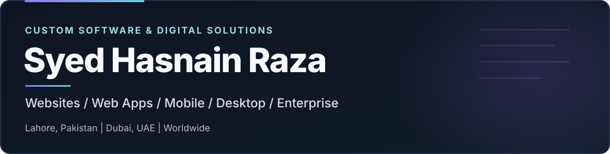

<!-- Portfolio profile: concise, responsive, and client-focused. Automated sections below are preserved. -->

  <picture>
    <source media="(max-width: 640px)" srcset="./assets/profile-banner-mobile.svg" />
    
  </picture>

### Software Developer & Technical Lead

I design and build practical digital products, from professional websites to custom business platforms, desktop tools, and mobile applications.

**[Discuss Your Project](mailto:razahasnain0300@gmail.com?subject=Custom%20Software%20Project%20Inquiry)** &nbsp; · &nbsp; **[View Selected Work](./PORTFOLIO.md)**

---

## About

I'm **Syed Hasnain Raza**, a software developer, IT manager, and electronic engineer working with **Syed's IT Solution & Digital Marketing Services**.

We work across web, mobile, desktop, and enterprise software. The project comes first: we select languages, frameworks, and infrastructure to match its requirements and the available delivery team.

**Based in Lahore, Pakistan and Dubai, UAE · Working with clients worldwide.**

## What we build

**Websites & e-commerce**  
Business websites, landing pages, portfolios, online stores, directories, and multi-vendor marketplaces.

**Web apps & business systems**  
Custom portals, SaaS platforms, ERP, CRM, CMS, HRMS, POS, LMS, dashboards, and management tools.

**Mobile & desktop applications**  
Android and iOS apps, Windows software, cross-platform desktop utilities, offline workflows, and device integrations.

**AI, APIs & automation**  
Assistants, integrations, reporting workflows, data systems, and operational automation.

[**Explore all software services**](./SERVICES.md)

## Selected projects

**Dr. Muhammad Shoaib Zafar — Healthcare platform**  
A psychiatry website and private clinic-system project, with specialist content, care pathways, and management workflows.

**RehabConnect — Healthcare discovery**  
A rehabilitation-centre and professional directory with location-based discovery and facility operations.

**Hadia Collection — E-commerce**  
A fashion storefront with product discovery, shopping features, and order-management workflows.

These are selected portfolio examples, not an exhaustive list. Public website screenshots and private-system capabilities are described separately in the case studies.

[**Explore portfolio, previews & case studies**](./PORTFOLIO.md)

## Technology

**Core experience:** JavaScript, TypeScript, React, Node.js, Python, SQL/MySQL, PostgreSQL, MongoDB, APIs, and automation.

**Other project options:** PHP, Java, Kotlin, Swift, Dart, C#, C/C++, Go, Rust, Flutter, React Native, .NET, Laravel, Spring Boot, Electron, Qt, and related ecosystems.

We assess additional languages and frameworks against the project's needs and verified team availability; this isn't a claim of expert proficiency in every technology.

[**View the full language & technology catalog**](./TECHNOLOGY_STACK.md)

## How we work

**Discover → Design → Develop → Integrate → Test → Deploy → Support**

Each engagement starts with a discussion of requirements, scope, delivery approach, and practical milestones.

## Contact

**Have a website, app, or software idea?** Send an overview of the project to discuss the right solution.

**Email:** [razahasnain0300@gmail.com](mailto:razahasnain0300@gmail.com?subject=Custom%20Software%20Project%20Inquiry)  
**Team:** Syed's IT Solution & Digital Marketing Services  
**Locations:** Lahore, Pakistan · Dubai, UAE · Worldwide collaboration

**[Request a Project Proposal](mailto:razahasnain0300@gmail.com?subject=Custom%20Software%20Project%20Inquiry)**

---

## More from the portfolio

Detailed showcases and activity are available below for visitors who want to explore further.

<strong>Complete project gallery</strong> — additional portfolio concepts and approved previews

<!-- AUTO-PROJECT-GALLERY:START -->
## Our latest software projects

**14 showcased projects** · Latest additions first · Live public-repository discovery

<table>
<tr>
<td width="50%" align="center" valign="top"> <b>ILLUSTRATIVE PORTFOLIO CONCEPT</b> <strong>MedBoostPro</strong> <b>🏷️ Healthcare / Education</b> Medical education and software platform concept</td>
<td width="50%" align="center" valign="top"> <b>REAL PUBLIC WEBSITE PREVIEW</b> <strong>DR. SHOAIB ZAFAR</strong> <b>🏷️ Psychiatry Clinic Website · CMS · Patient Services</b> Professional psychiatry website with care pathways, appointment access, specialist information and educational resources. <b>✨ FEATURES</b> <kbd>👨‍⚕️ Doctor Profile</kbd> <kbd>🧠 Adult Psychiatry</kbd> <kbd>🧒 Child &amp; Adolescent Care</kbd> <kbd>🧭 Recovery Pathways</kbd> <kbd>🧩 Addiction Information</kbd> <kbd>💬 Psychotherapy Services</kbd> <kbd>💻 Telepsychiatry</kbd> <kbd>📰 Mental-Health Articles</kbd> <b>⚙️ BUILT WITH</b> <kbd>React</kbd> <kbd>TypeScript</kbd> <kbd>TanStack Start</kbd> <kbd>Node.js</kbd> <kbd>Express</kbd> <kbd>MySQL</kbd></td>
</tr>
<tr>
<td width="50%" align="center" valign="top"> <b>ILLUSTRATIVE PORTFOLIO CONCEPT</b> <strong>GANI DESIGNER</strong> <b>🏷️ E-commerce</b> Independent retail storefront</td>
<td width="50%" align="center" valign="top"> <b>ILLUSTRATIVE PORTFOLIO CONCEPT</b> <strong>SYED&#x27;S COLLECTION</strong> <b>🏷️ Retail</b> Retail storefront and order-management concept</td>
</tr>
<tr>
<td width="50%" align="center" valign="top"> <b>ILLUSTRATIVE PORTFOLIO CONCEPT</b> <strong>OVER THE TOP CRM</strong> <b>🏷️ CRM / Operations</b> Gym memberships and device-integrated management</td>
<td width="50%" align="center" valign="top"> <b>ILLUSTRATIVE PORTFOLIO CONCEPT</b> <strong>SYDEX / JAVIZ</strong> <b>🏷️ Desktop / AI</b> Desktop AI assistant and automation concept</td>
</tr>
<tr>
<td width="50%" align="center" valign="top"> <b>REAL PUBLIC WEBSITE PREVIEW</b> <strong>REHABCONNECT</strong> <b>🏷️ Healthcare Directory · Rehab Finder · Facility Operations</b> Find rehabilitation centres and mental-health professionals, compare services and access recovery resources. <b>✨ FEATURES</b> <kbd>🏥 Rehab Centre Directory</kbd> <kbd>🩺 Professional Profiles</kbd> <kbd>🔎 Smart Care Finder</kbd> <kbd>📍 City &amp; Town Filters</kbd> <kbd>⚖️ Centre Comparison</kbd> <kbd>🧭 Care Matcher</kbd> <kbd>📚 Recovery Resources</kbd> <kbd>🧪 Research &amp; Insights</kbd> <b>⚙️ BUILT WITH</b> <kbd>React</kbd> <kbd>TypeScript</kbd> <kbd>TanStack Start</kbd> <kbd>Node.js</kbd> <kbd>Express</kbd> <kbd>MySQL</kbd></td>
<td width="50%" align="center" valign="top"> <b>REAL PUBLIC WEBSITE PREVIEW</b> <strong>HADIA COLLECTION</strong> <b>🏷️ Fashion E-Commerce Website / Online Store</b> Hadia &amp; Taha fashion storefront — curated collections, new arrivals, product browsing and customer shopping. <b>✨ FEATURES</b> <kbd>🛍️ Fashion Collections</kbd> <kbd>✨ New Arrivals</kbd> <kbd>🔎 Product Search</kbd> <kbd>🎛️ Catalog Filters</kbd> <kbd>📦 Color &amp; Size Options</kbd> <kbd>🛒 Shopping Cart</kbd> <kbd>💵 Cash on Delivery</kbd> <kbd>🚚 Order Tracking</kbd> <b>⚙️ BUILT WITH</b> <kbd>Node.js</kbd> <kbd>Express</kbd> <kbd>EJS</kbd> <kbd>MySQL</kbd> <kbd>Socket.IO</kbd></td>
</tr>
</table>

**[Explore all 14 projects and case studies →](./PORTFOLIO.md)**

*Project count is generated from public repositories and approved showcases; it is not a claim about undisclosed private projects. Public repositories refresh hourly. Private sources are not linked.*
<!-- AUTO-PROJECT-GALLERY:END -->

<strong>GitHub activity</strong> — contribution animation

<!-- PURPLE-SNAKE:START -->
## Purple Contribution Snake — Live GitHub Activity

<picture>
  <source media="(prefers-color-scheme: dark)" srcset="https://raw.githubusercontent.com/razahasnain0300-max/razahasnain0300-max/output/snake-purple-dark.svg" />
  <source media="(prefers-color-scheme: light)" srcset="https://raw.githubusercontent.com/razahasnain0300-max/razahasnain0300-max/output/snake-purple-light.svg" />
  
</picture>

**Real contributions. Purple motion.** This animation follows your genuine GitHub contribution calendar and refreshes twice daily through GitHub Actions — without creating artificial commits or changing GitHub's official contribution count.

**Animated project activity preview.** The animation is for presentation; it does not open developer files.

[**✉️ Request a project proposal →**](mailto:razahasnain0300@gmail.com?subject=Software%20Development%20Project%20Inquiry)

<!-- PURPLE-SNAKE:END -->

<strong>Automatically discovered public repositories</strong>

<!-- PUBLIC-REPO-AUTO:START -->
## Latest public project previews · Automatically updated

There are no additional **public** repositories currently. New public repositories will appear automatically after the next sync.

Project cards above show previews only.

*Updated approximately hourly. Project cards do not link to source code. Private repositories remain protected.*
<!-- PUBLIC-REPO-AUTO:END -->

<!-- APPROVED-CASESTUDIES:START -->
<!-- APPROVED-CASESTUDIES:END -->

Public profile graphics and case studies do not expose private application source code. Activity graphics show genuine GitHub activity, not fabricated contribution counts.
