# Software Solutions & Enterprise Services
**Syed's IT Solution & Digital Marketing Services** · Team-led, custom software solutions

[← Professional GitHub Profile](./README.md) · [Technology Matrix](./TECHNOLOGY_STACK.md) · [Selected Portfolio](./PORTFOLIO.md) · [Request a Quote](mailto:razahasnain0300@gmail.com?subject=Enterprise%20Software%20Development%20Inquiry)

## A complete digital-development partner

We plan and build purpose-specific digital systems, from small-business websites to integrated web platforms. Requirements, delivery team, architecture, licensing, security obligations and project scope are confirmed before implementation. **Service categories describe projects we can discuss; they are not blanket claims of specialist certification or guaranteed availability.**

## 1. Websites & marketing experiences

| Category | Common solution types |
|---|---|
| Corporate & business | Company websites, professional services, enterprise and B2B sites, agency websites |
| Personal & creative | Portfolios, resumes, personal brands, creator pages, professional bios, digital cards |
| Institutional & community | Education, healthcare, nonprofits, membership, directories, community hubs |
| Publishing | Blogs, magazines, news portals, resources, documentation, knowledge bases |
| Property & travel | Real-estate listings, tour pages, hotel/hospitality sites, property microsites |
| Events & experiences | Event sites, conferences, webinars, ticketing front ends, promotional campaigns |

**Landing-page formats:** PPC/ad campaign, lead generation, app launch, SaaS, product launch, prelaunch/waitlist, single-product checkout, webinar, online course, event registration, seasonal offer, recruitment, real-estate listing, book-a-demo, sales funnel, newsletter signup, local service, and conversion-focused A/B variations.

**Experience options:** Mobile-first and responsive layouts, accessible UI, multilingual presentation, performance optimization, SEO-friendly information architecture, contact/lead forms, CMS integration, analytics and conversion tracking as agreed.

## 2. Enterprise systems and business applications

| Business software | Modules / examples |
|---|---|
| **ERP** — Enterprise Resource Planning | Procurement, inventory, warehouse, purchasing, finance workflows, projects, payroll/HR integrations, operations, branch management, reporting |
| **CRM** — Customer Relationship Management | Customer records, inquiries, lead capture, sales pipeline, follow-ups, quotations, service tickets, integrations and dashboards |
| **CMS** — Content Management System | Page builder/editorial content, blogs, media libraries, author and reviewer roles, drafts, approvals, localization, scheduled publishing, SEO |
| **HRM / HRMS** | Staff directories, attendance, leave, permissions, onboarding, work schedules and HR reporting |
| **POS & retail** | Catalog and checkout, branch sales, stock, returns, receipts and sales analytics |
| **LMS / education** | Course catalogs, student portals, tutor/admin roles, quizzes, assessments and certifications where appropriate |
| **Inventory & logistics** | Product catalogs, stock transfers, barcodes, suppliers, dispatch, shipment tracking, order fulfillment |
| **Accounting & billing** | Quotes, invoices, subscriptions, expenses and finance-system integrations with applicable regulatory review |
| **Booking & service management** | Appointments, resource scheduling, calendars, inquiry processing, ticketing and customer notifications |
| **Property & construction** | Listings, lead management, project progress, tasks, documents, budgets and management dashboards |
| **Clinic / healthcare operations** | Appointments, staff/patient workflows, permissioned records, reporting and privacy-conscious system design |
| **Membership & gym** | Subscriptions, attendance, access devices, freeze/unfreeze workflows, trainer and member portals |

## 3. Custom websites, web apps and SaaS

B2B/B2C platforms; customer/vendor/admin portals; multi-tenant SaaS; PWA/offline-first apps; marketplaces; online stores; subscription products; vendor/seller dashboards; comparison/directories; job boards; helpdesks; surveys/forms; analytics and KPI consoles; knowledge bases; role-based team collaboration; internal tools; automation dashboards.

**E-commerce possibilities:** B2C, B2B and multi-vendor commerce; product variants, inventory, wishlists, carts, checkout, shipping, order tracking, discount systems and approved payment/provider integrations.

## 4. Android, iOS and desktop applications

| Platform | Possible solutions |
|---|---|
| Android apps | Native Kotlin/Java or agreed cross-platform mobile implementation |
| iOS apps | Native Swift/SwiftUI or agreed cross-platform mobile implementation |
| Cross-platform | Flutter/Dart, React Native/TypeScript or other technically suitable approaches |
| Windows desktop | Electron, Python, .NET / WPF / WinUI or other appropriate tools |
| macOS / Linux desktop | Electron, Tauri, Qt or other feasible packaging options |
| Desktop utilities | Device integrations, offline tools, management utilities, companion apps, synchronization and automation |

Design decisions depend on OS versions, hardware access, app-store rules, security and actual specialist availability.

## 5. Systems, AI and integrations

REST/GraphQL APIs, payment/shipping/messaging providers, CRM/ERP connectors, webhooks, synchronization, monitoring, reports, analytics exports, scheduled tasks, operational dashboards, LLM-backed assistants, document-processing workflows and knowledge-search interfaces where suitable.

AI functionality requires appropriate evaluation of data privacy, accuracy, safety and operating costs. We do not claim all integrations are available without reviewing the provider's API and constraints.

## 6. Engineering, growth & delivery

Research and architecture; UI/UX; implementation; authentication and roles; data modeling; automated testing; security reviews; staging and deployment; CI/CD; infrastructure, backups and monitoring; SEO and technical performance; maintenance and improvement.

### Our workflow

**Discover → Design → Develop → Test → Deploy → Support.** A proposal identifies the appropriate technology stack, project deliverables, timeline, and the team roles available for the engagement.

**[✉️ Share your project requirements and request a quote](mailto:razahasnain0300@gmail.com?subject=Enterprise%20Software%20Development%20Inquiry)**

*Our public portfolio uses high-level design concepts where projects are privately sourced. No confidential client source code, access credentials or protected information is shared here.*
