# Programming Languages, Frameworks & Platforms
**Syed's IT Solution & Digital Marketing Services** · Web, desktop, mobile & enterprise engineering · **Lahore, Pakistan | Dubai, UAE | Worldwide**.

[← GitHub Profile](./README.md) · [Software Services](./SERVICES.md) · [Project Portfolio](./PORTFOLIO.md) · [Request a Quote](mailto:razahasnain0300@gmail.com?subject=Enterprise%20Software%20Development%20Inquiry)

## Our approach to selecting technology

The best technology is the one that meets the business requirements, integrates with existing systems, is maintainable, and can be supported by the assigned delivery team. **This is a broad architecture and technology catalog, not a claim that every language or framework is an in-house specialization.**

**Core demonstrated project experience:** JavaScript, TypeScript, HTML, CSS, React, Node.js, Express, Python, SQL, MySQL, PostgreSQL, MongoDB, REST APIs, Electron-based desktop and automation workflows, Linux/VPS deployment.

**Additional ecosystems for project evaluation:** Next.js, Three.js, .NET/C#, Java, Spring, Kotlin, Swift, Dart/Flutter, PHP, C/C++, Go, Rust, Ruby and other platforms. Team qualification, staffing, third-party dependencies and delivery feasibility are verified during planning.

## Programming language directory

We are **technology-flexible**, with implementation decisions based on requirements, engineering suitability and verified staffing. These languages are listed as **options to evaluate**, not a statement that every one is an established individual specialization.

| Category | Programming languages and scripting options |
|---|---|
| Web and browser applications | **JavaScript, TypeScript, PHP**, Python, Ruby, Go |
| APIs and enterprise software | **C#, Java, Python, TypeScript, PHP, Kotlin**, Go, Rust, Ruby, Scala, F#, Visual Basic .NET |
| Android and iOS | **Kotlin, Java, Swift, Objective-C, Dart, JavaScript, TypeScript**, C# |
| Windows/macOS/Linux desktop | **C#, C++, Python, Java, JavaScript, TypeScript, Rust, C, Swift**, Dart, Visual Basic .NET |
| Systems, embedded and devices | **C, C++, Rust, Python**, Assembly, MicroPython, C# |
| Data, analytics and automation | **SQL, Python, R, Bash, PowerShell**, Julia, MATLAB, Perl |
| Specialized ecosystems, where appropriate | **Go, Scala, Lua, Elixir, Erlang, Haskell, Clojure, Solidity**, F#, Delphi/Object Pascal |
| Web markup and styling (not general-purpose programming languages) | **HTML5, CSS3, Sass/SCSS, XML**, Markdown |

**Common framework choices:** React, Next.js, Vue, Angular, Svelte, Node.js, Express, NestJS, Django, Flask, FastAPI, Laravel, Spring Boot, ASP.NET Core, React Native, Flutter, Jetpack Compose, SwiftUI, .NET MAUI, Electron, Tauri, Qt and other appropriate ecosystems.

Our documented core background remains **JavaScript/TypeScript, React, Node.js, Python, SQL databases, MongoDB, APIs, DevOps and automation**. All other languages and platforms are subject to solution design and qualification.

## Web foundations and frontend engineering

| Category | Languages and tools |
|---|---|
| Markup and styles | HTML5, semantic HTML, CSS3, SCSS/Sass, responsive design, accessibility, CSS animations |
| Core web languages | JavaScript (ES6+), TypeScript |
| Frontend frameworks | React, Next.js, Vue.js, Nuxt, Angular, Svelte, SvelteKit, Remix / React Router, TanStack Start |
| Interactive experiences | Three.js, WebGL-oriented interfaces, GSAP, SVG animation, Canvas, React Three Fiber |
| Styling and components | Tailwind CSS, Bootstrap, Material UI, Shadcn UI, design systems |
| Site architecture | Static sites, SSR, SSG, hybrid rendering, PWAs, microfrontends, API-driven UI |

## Backend applications, APIs and enterprise development

| Ecosystem | Languages and technologies |
|---|---|
| JavaScript & TypeScript | Node.js, Express.js, NestJS, Fastify, REST APIs |
| Python | Python, Django, Flask, FastAPI, background jobs, data processing |
| Microsoft & enterprise | C#, .NET, ASP.NET Core, Blazor, Entity Framework Core, Windows services |
| Java & JVM | Java, Kotlin, Spring Boot, Jakarta EE, Gradle, Maven |
| PHP | PHP, Laravel, Symfony, CodeIgniter |
| Ruby | Ruby, Ruby on Rails |
| Go | Go (Golang), API services and concurrency-oriented backend systems |
| Rust & C/C++ | Rust, C, C++, performance-sensitive or native components where warranted |
| Interface patterns | REST, GraphQL, gRPC, WebSockets, webhooks, queues, asynchronous processing |

## Websites, CMS, e-commerce and business platforms

| Category | Examples |
|---|---|
| CMS & publishing | WordPress, Drupal, Strapi, Payload CMS, Sanity, Contentful, Directus, custom CMS |
| Web commerce | WooCommerce, Shopify, Magento / Adobe Commerce, custom carts and storefronts |
| Business platforms | Custom ERP, CRM, CMS, HRMS, LMS, POS, inventory, procurement, customer/admin portals |
| Site builders | Webflow and other builder platforms when suitable to content ownership and goals |
| Search and visibility | Metadata, canonical URLs, schema, sitemaps, accessibility and performance |

## Desktop and native software

| Operating systems | Implementation options |
|---|---|
| Windows | Electron/Node.js, Python/PySide/PyQt, C#/.NET with WPF or WinUI, Java |
| macOS | Electron, Tauri, Swift/SwiftUI and desktop toolkits |
| Linux | Electron, Tauri, Qt, Python and supported native packages |
| High-performance or cross-platform native | C++, Rust, Qt, suitable OS SDKs |

## Android, iOS and cross-platform mobile

| Target | Languages and frameworks |
|---|---|
| Android native | Kotlin, Java, Android SDK, Jetpack Compose |
| iOS native | Swift, SwiftUI, Objective-C (legacy ecosystems) |
| Cross-platform | React Native (JavaScript/TypeScript), Flutter (Dart), Ionic / Capacitor |
| Mobile data and communication | REST/GraphQL APIs, push messaging, synchronization, offline storage, authentication |

App-store publishing, account access, compliance and any regulated-domain requirements are scoped independently.

## Data, analytics and infrastructure

| Group | Technologies / approaches |
|---|---|
| SQL databases | MySQL, MariaDB, PostgreSQL, Microsoft SQL Server, SQLite |
| Non-relational and caching | MongoDB, Redis, Firestore/Firebase, DynamoDB (where justified) |
| Search & analytics | Elasticsearch / OpenSearch, analytics dashboards, exports, reporting pipelines |
| Cloud and hosting | Hostinger VPS, Linux, Nginx, PM2, Docker, AWS, Microsoft Azure, Google Cloud, Cloudflare |
| Release and operations | Git, GitHub Actions, CI/CD, containers, backups, monitoring, logging, infrastructure as code |
| Security patterns | Role-based authorization, secure cookies, CSRF/CORS controls, TLS, secret management, dependency updates |

## Programming and scripting languages at a glance

- **Web and full-stack:** JavaScript, TypeScript, HTML, CSS, PHP, Python, Ruby, Go.
- **Enterprise and API services:** C#, Java, Kotlin, Python, TypeScript, Go, Rust.
- **Desktop and systems:** C, C++, C#, Python, Java, Rust, Swift.
- **Android/iOS:** Kotlin, Java, Swift, Objective-C, Dart, JavaScript/TypeScript.
- **Data and automation:** SQL, Python, Bash, PowerShell, R (use-case dependent).
- **Additional or specialized stacks:** Other relevant languages and frameworks considered through discovery, feasibility and specialist review.

*HTML and CSS are markup/styling technologies rather than general-purpose programming languages. Brand names listed here are third-party ecosystems, not endorsements or certifications.*

## Choose the right stack for the product

| Solution | Example technology approaches to evaluate |
|---|---|
| Small business website, CMS or online store | Custom React/Next.js, WordPress/WooCommerce, Shopify, PHP/Laravel or other suitable CMS |
| Large web portal, SaaS, ERP or CRM | React/Vue/Angular + Node.js/Python/.NET/Java + relational database |
| Android mobile application | Native Kotlin/Java, Flutter/Dart, React Native/TypeScript |
| Android + iOS mobile application | Flutter/Dart, React Native, or separate Kotlin and Swift codebases |
| Windows business software | C#/.NET, Python/PySide, Electron, Java or Qt |
| Cross-platform desktop utility | Electron, Tauri, Qt, Flutter desktop or another supported desktop toolkit |
| AI-enabled custom workflow | Python or JavaScript/TypeScript orchestration with suitable APIs, models, privacy and quality checks |
| Embedded/hardware-connected app | C/C++/Python/Rust and vendor SDKs where compatibility is demonstrated |

These are **architectural examples**, not promises that every provider, framework or deployment target is supported without discovery.

## How we work as a team

**Discovery → UX → Architecture → Development → Integration → QA → Deployment → Support.** The exact engineer(s), project plan, timeline and technical ownership are decided for each contract. We do not represent a fixed staffing count, every possible professional certification or guaranteed availability for each technology.

**[✉️ Request a project consultation](mailto:razahasnain0300@gmail.com?subject=Enterprise%20Software%20Development%20Inquiry)**

[View our software solutions](./SERVICES.md) · [Return to the GitHub profile](./README.md)
